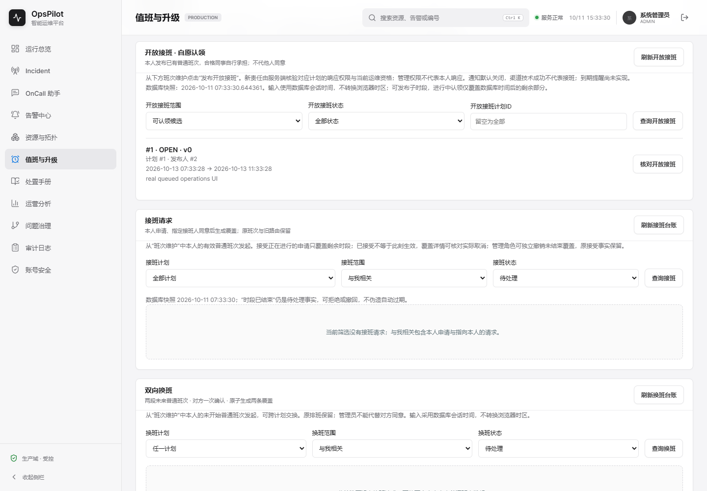
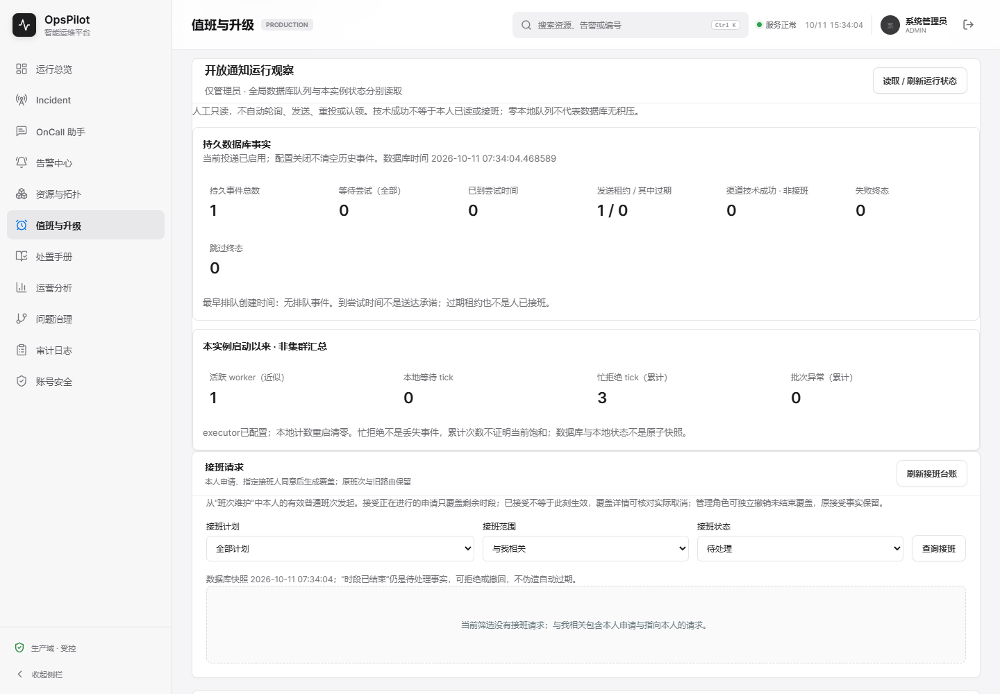
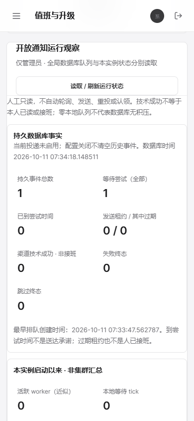

# OpsPilot V1.7 CP121：管理员手动队列面板与真实页面验收

## 范围与结论

2026-10-11。本轮将CP120的只读接口接入“值班与升级”管理员页面，不增加发送、重投、自动轮询、认领或新的数据库迁移。当前ACTIVE/ADMIN由服务端负责，前端角色仅作显示与会话围栏。旧Demo和历史报告保留，不将上一轮远端结果替代本轮自身Linux验证。

新12项真实页面流程、前端222项、Node262项与生产构建/打包本地通过；新增第十一独立Linux UI作业，自己的新CI待验。整个持续迭代目标仍active，不等于100%。

## 页面契约

- 初始“尚未读取”，只有点击“读取 / 刷新运行状态”才请求全局GET。未知或读取失败不显示零积压，也不沿用旧事实。
- 持久数据库总量、到期等待、租约与终态和本进程worker活跃/忙拒绝累计分别展示。两者不是原子快照，重启本地计数清零不等于历史积压消失。
- 配置关闭仍显示已有数据库积压；本地等待tick=0不等于数据库无事件，忙拒绝累计也不能证明当前饱和。
- 技术成功不是本人已读或接班；没有发送正文、渠道、令牌或收件人明细，保留既有单请求回执页面。
- 新GET捕获账号/token并传AbortSignal；每次读取、身份变化、原生跨标签storage事件或卸载均清除旧事实。epoch与账号/token双检查阻止晚200回填。
- 运行时校验scope、计数/分区、时间和空值，不把矛盾200解释为可用事实。executor shutdown仅“已请求关闭”，允许尚有活跃线程，不冒称已终止。

## 真实页面与限定夹具

使用自己的新JAR `740e1c722a65634e036a0e8d61cb1a4244f181bf09e04720124124ef94c6cc19`，独立H2文件库、loopback认证HTTP接收器及三次JVM生命周期。先由真实业务API发布一条原候选只有admin的开放事件，而非SQL造队列。

| 流程 | 证据与边界 |
| --- | --- |
| 初始/人工读取 | 0自动全局GET；实PENDING=1、pendingDue=1，未读不造零 |
| 实际阻塞HTTP | 数据库CLAIMED=1、activeWorker=1、queuedTicks=0、忙拒绝增加；不是模拟worker数字 |
| 接收器真实503 | 回到PENDING=1、pendingDue=0、技术成功0；保持原投递键/载荷，尚未到重试时间 |
| 禁用重启 | 数据库仍有原PENDING，enabled=false、本地worker/忙拒绝为0；关闭不清空事件 |
| 故障清除 | 浏览器明确控制503和修改分区的矛盾200；各自清事实，不宣称真实生产库此刻损坏 |
| 跨标签换账号 | sibling同源localStorage写入真实登录会话，浏览器原生trusted storage事件；旧实际200不回填、错存储账号不再发GET |
| 不信任存储角色 | 审计员真实JWT配控制的admin显示提示，服务端实际403；不是数据库撤销管理员场景 |
| 三种非管理员 | 审计员/值班员/运维经理真实登录，无面板且无全局GET |
| 同管理员换token | 新登录真实不同token、原生storage事件，旧实际200不回填 |
| 导航卸载 | full page navigation卸载后重进页面仍未读；不把这项写成SPA路由专项 |

12项新流程中浏览器业务POST=0，页面运行异常=0；两个console错误仅对应预期全局读取503/403。最终所有JVM先认证shutdown200、退出且完整Hikari有序关闭，再执行只读SQL SNAPSHOT：V1–V41成功、原事件PENDING/attempt1/HTTP_503，无租约/送达时间，开放申请仍OPEN/v0，无认领、覆盖或操作流水。接收器关闭、9931/9932释放。无用户数据库改动、无认证token落证据。

## QA环境、视觉与命令

目标：`http://127.0.0.1:9931/on-call` → 管理员手动读取 → 真实积压/worker状态和错误/身份变化清除。

Browser plugin not available；按frontend-testing-debugging使用项目现有Playwright1.63.0与本机Chrome155.0.8059.39，没有安装依赖。桌面1440×1000、手机390×844；页面URL/title、正文非空、无框架overlay、解释console、实按钮交互和截图均已检查。7张新截图、2张旧截图均有SHA256和宽度边界，手机无横向溢出；初始首屏另保存，不等于所有页面/浏览器视觉矩阵完成。

旧实际CP120 JAR `8117714fcd28da726e0c0f2b9ccf3d3d1a3ff08a4c98b8b732cac5bbfa2c8656`：已有GET接口但无全局面板，两张真实旧页面图；单独启动/认证关闭/只读SQL，未发渠道HTTP。新旧JAR存target不上传大二进制，旧生成index/JS/CSS从不可变父提交另行归档，不恢复旧文件覆盖当前构建。

```powershell
npm test --prefix web
npm run build --prefix web
./mvnw.cmd -B '-Dmaven.repo.local=D:/Codex/国网/tmp/m2-repository' -DskipTests package
node scripts/verify-oncall-open-notification-operations-ui-ci.cjs
node scripts/verify-oncall-open-notification-operations-ui-evidence.cjs target/oncall-open-notification-operations-ui-it/run-QwtWMs
node --test scripts/tests/*.test.cjs
```

Node262含8项新证据门禁：从保存的真实工件独立重放及负对照，并非又执行8次浏览器。生产Java与V1–V41不变；本轮未重新执行默认590/265，不将父版本的Java结果当新一轮执行。仅只读SQL夹具扩充自有临时目录allowlist。真SnakeYAML拒绝重复键，原21与此前10专项定义完全不变，新Linux作业从自身源码重建前端/JAR、安装锁定Playwright Chromium、失败也保存工件。

当前新JAR的原开放接班33、通知11、成员25页面回归均实际通过；后两项另由原独立门禁重放通过。三个原runner未改，保留各自完整原始结果/日志/截图，不把不同范围相加成同一套业务用例。原开放runner采用原有stopProcess清理，仅据其结果声明进程退出，不伪称三个回归均为认证优雅shutdown。本轮完整证据与源码摘要见[local-proof](../assets/v1.7-cp121/local-proof.json)，[原始12项结果](../assets/v1.7-cp121/final-operations-ui/result.json)和[独立门禁](../assets/v1.7-cp121/final-operations-ui/gate-result.json)。

## CP120自身远端闭合

父源码 `396c806c67807e676cb9a2d1ab3716bbf79218aa`：[主CI38080331379](https://github.com/Trigger726/OnCall-Agent/actions/runs/38080331379)21作业及[专项38080331381](https://github.com/Trigger726/OnCall-Agent/actions/runs/38080331381)10作业均completed/success，保存原API结果。自己的新增MySQL七项官方ZIP（artifact11680252296）下载SHA256与官方 `b5e1a0b5aba70a45fe3e08249534298e9d382ebe1477d7588762d8d91c7bbbf1` 相等，使用父不可变提交的门禁独立重放并与工件保存结果相等：实际MySQL7、3认证HTTP、100忙拒绝、本地队列0、权限/只读/405/池关闭限定通过。

见[独立remote-proof](../assets/v1.7-cp121/cp120-own-operations-remote-proof.json)；其余9个专项ZIP本轮未逐一重放，作业success不冒称每个工件已独立验收。本轮页面不是MySQL UI验收，不借父CI为新Linux背书。

## 剩余与技能影响

frontend-testing-debugging推动真实网页交互、桌面/手机与错误/身份矩阵；karpathy-guidelines限定为人工只读新组件，不重构原投递/认领。此次不照搬外部截图的风险百分比或装饰图表。

自身Linux UI/完整新CI、MySQL全JAR通知升级重启、第三方真实账户映射/送达/已读、提醒/手工重投/保留、告警规则与大规模容量、跨节点HA计数、私有计划读隔离、认领撤销完整矩阵、DST、原始OnCall全能力对照均仍有剩余。没有将近似本地worker或SQL观察升级成生产SLA、集群健康或整个目标100%。

## 新旧截图

旧版无面板：



新版真实阻塞worker及手机禁用仍有积压：




## CP121自身远端闭合（CP122追加，2026-10-11）

追加保留上述上传时“待验”历史。自己源码 `d739bca2c1060f9cc639725fa903fc8e0554aaf7` 的[主CI38122379999](https://github.com/Trigger726/OnCall-Agent/actions/runs/38122379999)21作业和[专项38122380003](https://github.com/Trigger726/OnCall-Agent/actions/runs/38122380003)11作业均completed/success，每个job核对同一head_sha；原API状态保存在CP122资产。

新运行观察UI官方ZIP artifact11696070484，下载SHA256与官方 `db627c260d7d9288f45601bdccae029d788545d4286fdfc30b8e64744a5fb275` 相等。用d739bca不可变提交的原版门禁独立重放，并与工件gate-result完全相等：Linux Playwright Chromium153.0.8010.12、12实页流程、7截图、1认证503接收器HTTP、SQL只读确认、3认证关闭JVM及本地端口释放，限定通过。见[官方原始证据与独立proof](../assets/v1.7-cp122/cp121-own-ui-remote-proof.json)。通用门禁的ownLinuxUiVerified=false是不含外部来源判断的固定返回；本节独立核对来源、源码和作业后才声明自己的Linux12闭合，不改工件本身。

其余十专项ZIP本轮未逐一独立重放，作业success不扩大为所有工件已逐字节验收。此UI仍是H2临时库，不证明MySQL页面、生产容量/HA/真实渠道账户或整个目标100%；完整MySQL通知JAR升级链路继续见[CP122](V1.7-checkpoint-122.md)。
