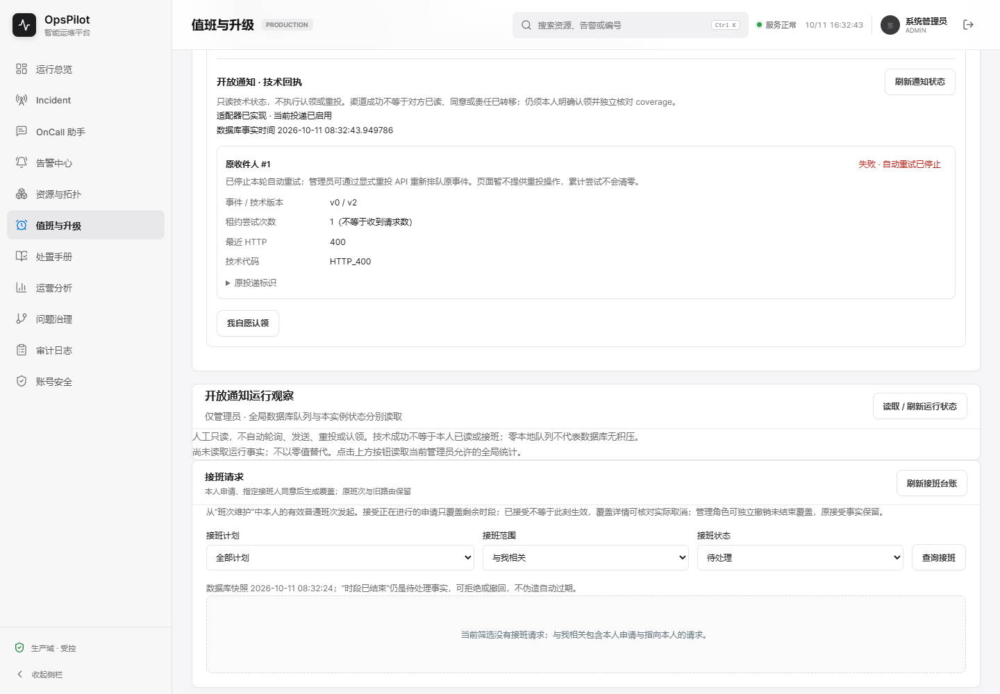
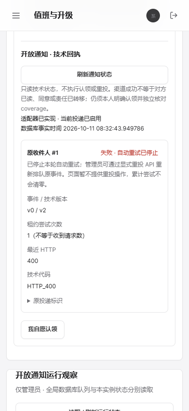

# OpsPilot V1.7 CP123：FAILED通知的显式人工重投

后续状态（CP124，2026-10-11）：本源码0d082210自己的主38125661990共21、专项38125661999共12全部success；新MySQL共享37及非空V41五状态→V42官方ZIP11697900110以本源码原门禁独立重放通过，摘要匹配。见[CP124限定闭合及整包TCP](V1.7-checkpoint-124.md)与[独立proof](../assets/v1.7-cp124/cp123-own-mysql-proof.json)。以下保留CP123原始时点；CP124的新人工重投整包MySQL未由此证明。

2026-10-11。新增业务API、V42持久操作回执与按轮预算，不只是测试或界面改版。主工作区未切分支、reset或恢复旧文件；历史Demo保留，整个目标active、不称100%。当前自身MySQL/新CI待验。

## 业务契约

`POST /api/v1/on-call/open-handoffs/{id}/notifications/{notificationId}/redrives` 提交明确的**通知**version、规范UUID operationKey与1–500字reason。只接受本请求当前FAILED的原事件，原候选须仍满足计划、双方账号/响应资格、源班次/版本、剩余窗口及不冲突条件。原收件人、载荷和deliveryKey不换，不补新人、不新建通知、不inline HTTP、不代人认领。

当前ACTIVE ADMIN沿用已有计划管理覆盖权；OPS_MANAGER还须本计划有效can_manage授权。回放也先核对当前权限，不凭旧角色/旧管理权写入。普通ON_CALL/AUDITOR无此写权；既有全局认证历史读取不变，本轮没有实现私有计划读隔离。

| 情况 | 行为 |
| --- | --- |
| 首次合法操作 | 同事务FAILED→PENDING、version+1、不可变ledger、审计 |
| 相同actor/key/通知/version/规范化reason | 原receipt不变；currentDelivery独立读取，replayed=true，不重新排队或追加审计 |
| 同actor/key更换通知、版本或reason | 409 OPERATION_KEY_REUSED，无写入 |
| 不同actor的相同字符串key | 当前管理权限成立时独立命名空间，不冒领他人回执 |
| 非FAILED、旧版本、INT计数预算不足 | 409，无写入 |
| 原候选不合格或适配器关闭 | 新操作409；旧回执当前权限仍成立时只读确认 |
| 未登录／无当前管理权限／错请求通知／缺版本或坏键 | 401／403／404／400 |

`attempts`累计不清零；新增cycle_start_attempts仅记录本轮起点，每次明确人工授权开启当前配置下有上限的新轮，退避按本轮次数计算。原HTTP/错误保留到下一次尝试，ledger永久保存此轮前版本、次数、HTTP/错误、actor/key/reason、原deliveryKey及接受时间。新轮完成/申请撤回后回放第一轮原键，只返回当时回执，不重新发送。

锁顺序为计划→开放请求→排序账号→通知，与原成员/发布/认领顺序一致；actor锁串行化跨事件键。实际审计写后失败会回滚队列和ledger。网络仍由独立调度器在事务外执行；旧租约token/期限CAS阻止过期worker覆盖人工新轮回执。资格观察与远端HTTP不原子，超时请求可能已到达，稳定键也不保证任意第三方去重；不宣称exactly-once、本人已读或接班。

## 实际测试、迁移及边界

最终默认package：888发现、606实际执行、282条件跳过、104 XML零failure/error；Node275、前端223及构建通过。见[默认清单](../assets/v1.7-cp123/default-java-summary.json)、[37场景门禁](../assets/v1.7-cp123/selected/notification-gate.json)和[迁移门禁](../assets/v1.7-cp123/selected/migration-gate.json)。MySQL本机条件跳过，未连接用户MySQL或启动缺失的Docker daemon。

原22通知测试保留，新15覆盖同键同载荷/无inline HTTP、每轮上限和累计5次、关闭后的原确认、不同意图与跨事件键、当前管理撤权/actor隔离、六类原资格失效、非FAILED/坏版本/错请求、实际审计写后回滚、并发同键一次回执、不同键同版本单赢家、旧租约跨耗尽/人工新轮、禁用新写及INT预算、认证HTTP校验。实际SQL与真实接收器43次认证HTTP；新控制器写经MockMvc，不冒称本轮已覆盖人工重投API整包TCP响应丢失/重启矩阵。

V1–V41逐个Git blob不改，V42追加默认0起点与ledger，不回填人工操作。专有H2先真的迁移到41，填入PENDING/CLAIMED/DELIVERED/FAILED/SKIPPED五状态、Unicode载荷、键、租约、HTTP、版本和次数，再只执行1个42；全部旧列、原41checksum不变，起点全0、ledger0，再迁移为0。共享MySQL37及第二个Testcontainers MySQL8.4五状态迁移已加入原12专项范围，本轮真实新MySQL等待自己的CI。

当前升级/跨节点/JAR/浏览器门禁明确要求42。历史函数只在显式参数下重放旧证据，CLI默认仍42；老22项V41不能通过新37项默认门禁，有正/负对照。合成MySQL夹具仅是结构测试，不把旧JAR说成执行过42。原主21作业定义不变，原12专项范围保留；5项只改当前迁移命名或增加第二MySQL迁移步骤，真SnakeYAML/重复键负例[通过](../assets/v1.7-cp123/local-logs/cp123-yaml.log)。

最初夹具误用不可变properties setter及Long实参导致编译失败，nullable ternary拆箱导致迁移夹具失败；当前边界提升后16项fixture首次失败均保留。修正夹具/明确42，没删旧场景或放宽MySQL真实性。YAML辅助验证首次写错原job键http而非jar，修正检查预期、未改工作流迎合检查。见[迁移首失败](../assets/v1.7-cp123/first-failures/migration-null-fixture.log)与[门禁首失败](../assets/v1.7-cp123/local-logs/cp123-node-first.log)。

从不可变83a684重建V40的原七步完整JAR实际升级到42：7认证有序关闭/SQL快照、2真实503→200同键/载荷、撤权跳过和最后人的明确claim通过；这不是新人工重投整包证明。见[七步门禁](../assets/v1.7-cp123/h2-notification-jar/gate-result.json)。旧CP122 JAR SHA740e1c完整保留在忽略target，历史Demo和资产摘要不改。

## 页面QA与新旧Demo

只更新FAILED说明与累计次数解析：旧页称没有手工重投入口；新页明确管理员有API，但页面无操作按钮、累计次数不清零。仍只读，不因失败自动POST。旧[CP119](V1.7-checkpoint-119.md)和[CP121](V1.7-checkpoint-121.md)Demo保留，不称新可点击重投页面完成。

环境：`http://127.0.0.1:9941/on-call`、Chrome155/现有Playwright1.63.0、1440×1000与390×844；Browser plugin not available。实际登录→查询→PENDING/租约/503→选择400FAILED/刷新→换请求/原生跨标签换身份/审计员读取；11场景、10截图、4认证HTTP、3有序JVM关闭、42 SQL通过，无业务POST。见[页面结果](../assets/v1.7-cp123/notification-ui/result.json)/[门禁](../assets/v1.7-cp123/notification-ui/gate-result.json)。

| QA检查 | 结果 |
| --- | --- |
| URL/title、非空、无框架overlay | 通过，真实应用 |
| console | 仅已解释的控制503/原生abort，无未解释应用错误 |
| 实际交互、请求/身份围栏、失败清空旧事实 | 通过 |
| FAILED新说明、桌面/手机换行和宽度 | 通过，实际PNG/摘要复核 |

frontend-testing-debugging促使实页验证而非只看构建，karpathy-guidelines促使最小持久闭环并保留失败。未验新写按钮、Linux本轮自身浏览器或第三方送达，可安装Browser插件改善应用内调试。

## CP122自身远端闭合

源码2730e307自己的[主38123610453](https://github.com/Trigger726/OnCall-Agent/actions/runs/38123610453)21和[专项38123610445](https://github.com/Trigger726/OnCall-Agent/actions/runs/38123610445)12全部success，逐job核对head_sha。新MySQL七步官方ZIP11696541847摘要与下载一致：77e30b8b1a813f837bce79a53505a935641a986caea439350f4e564484107b03；以自身2730原门禁独立重放与保存gate相同，实际8.4.11/随机schema/同UUID、最终JDBC、7JVM/两端口及容器清理成立。见[remote-proof](../assets/v1.7-cp123/cp122-own-mysql-remote-proof.json)。其余11 ZIP未逐个独立重放，不能闭合当前新42重投。

## 参照与后续

原始OnCall归档0cd654 README明确RAG、Planner-Executor-Replanner问答、告警/日志工具与SSE；这是已有OpsPilot值班链路的受控运营写能力，不把README当完整源码审计。[Alerta官方格式](https://docs.alerta.io/api/alert.html)记录状态/严重度history，[GoAlert官方指南](https://goalert.me/docs/goalert-features/quickstart-guide/)将通知设置与人的ack/close分开。据此推导“技术投递／人的重投授权／人的接班”独立事实，不声称厂商实现了相同API或ledger。

下一轮核验新源码自身MySQL37/V41升级和CI，补人工重投完整JAR/TCP丢响应与重启，再做显式确认的前端写入口。提醒/保留、真实渠道账号及已读、容量告警、跨机HA、私有读隔离、认领撤销/DST及原始OnCall/成熟Incident完整能力对照仍未闭合。摘要见[local-proof](../assets/v1.7-cp123/local-proof.json)。

### 截图

