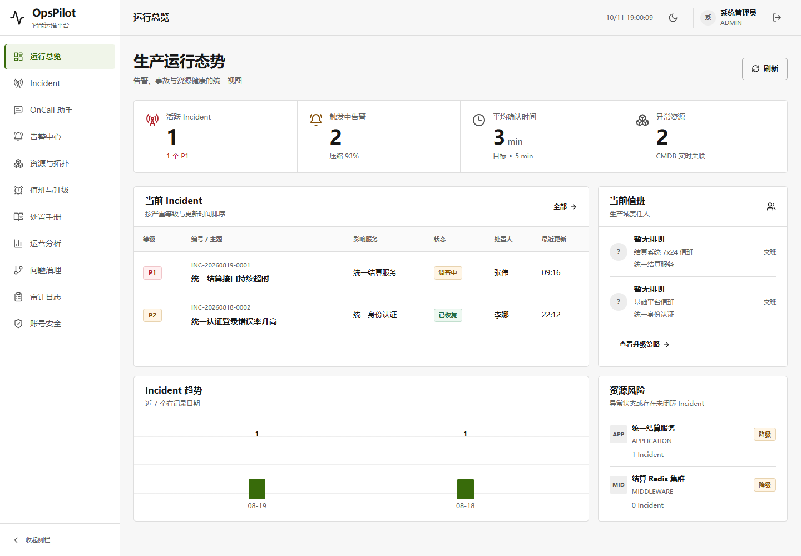
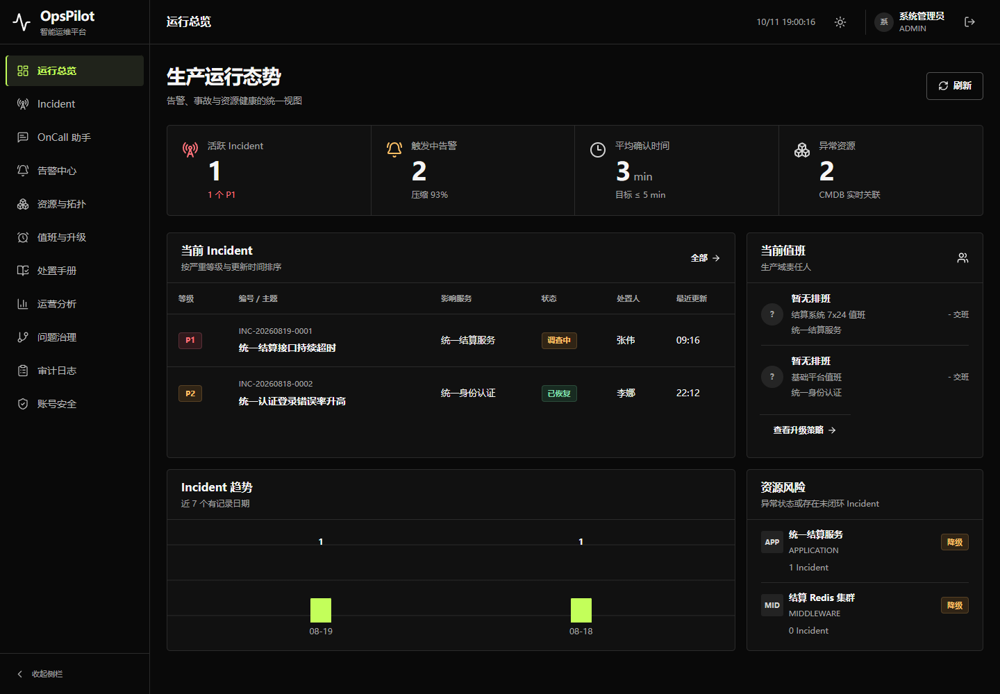
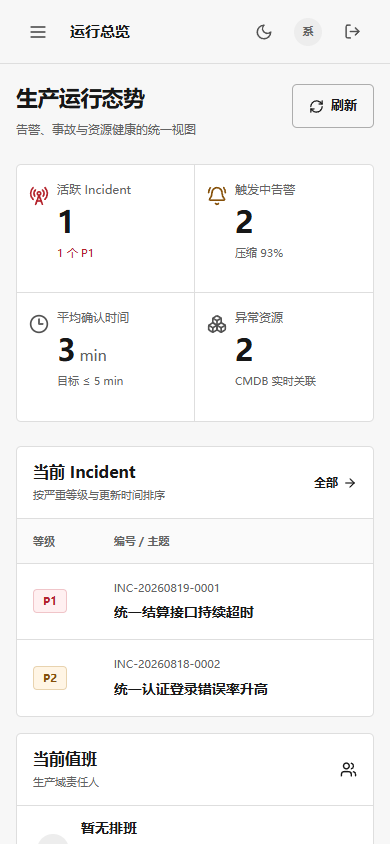

# V1.7 UI 精修：使用 Anthropic frontend-design skill

用户要求在网上查看或下载“claude ui design”并用于优化。名称存在多个社区版本；本轮选择 [Anthropic 官方 frontend-design](https://claude.com/marketplace/plugins/frontend-design)，不冒称已经找到唯一同名仓库。

## Skill 与边界

已通过 skill-installer 下载并完整读取 [固定版本源码](https://github.com/anthropics/skills/blob/dbd4588f9e1033efb41dad4bef2f7947c8993d44/skills/frontend-design/SKILL.md)，安装于 `C:/Users/lenovo/.codex/skills/frontend-design`，附 Apache-2.0 许可。它是设计工作说明，不是调用 Claude 模型或安装 Claude 客户端；没有执行下载仓库中的脚本。

顺序：skill-installer → 用户指定的 frontend-design 设计/自检流程 → frontend-app-builder 既有设计系统细修 → frontend-testing-debugging 实页检查；karpathy-guidelines 限定源码改动范围。适用既有设计小改例外，不重新生成 Image Gen 概念或复制第三方品牌。原双主题截图作为视觉基线，并在同一验收中检查修改后的实际截图。

保留用户已指定的 OKX 风格、Codex 默认字体、双主题、全部真实文案/指标/11 条路由及封版业务。外部 skill 的字体建议不覆盖用户的明确字体要求。

## 先定方案，再检查是否符合需求

对象：值班运维人员；主要任务：发现当前 Incident、确认责任人，再进入处置流程。界面不是营销首页。

配色锁定已有 token：浅色画布 `#f7f7f7`、面板 `#ffffff`、文字 `#171717`、次级 `#636363`、边界 `#dedede`、当前项 `#386b0a`；深色沿用 `#090909/#111111/#f5f5f5/#a3a3a3/#2b2b2b/#c3ff5a`。字体不换，只调整尺度与层级。

原方案的问题：四个独立指标卡和大段空白竞争注意力，表头/编号/值班说明仅 9–11px，难以快速扫读。修订为连续指标栏，将最主要的业务信息留给 Incident 表格，减少重复外框；不换成通用营销布局、奶油色/衬线字体或装饰渐变。

```text
侧栏 │ 页名                                   主题 / 用户 / 退出
     │ 生产运行态势                                  刷新
     │ 活跃 Incident │ 触发中告警 │ 确认时间 │ 异常资源
     │ 当前 Incident 表格                 │ 当前值班
     │ Incident 趋势                      │ 资源风险
```

全部左对齐，共用边界与间距；指标值使用现有等宽数字特性，不将正文改为等宽。正文/业务行 13–14px，辅助说明 11–12px，面板标题 16px，主要标题 28px。基础间距 4/8/12/16/24/32px；不添加逐卡片入场动画，操作状态变化保留，尊重 reduced-motion。

完整首屏文案、导航、按钮和数据来自既有 Vue 模板，不新增标签、徽章、虚构趋势或环境健康断言。图标沿用 Lucide 线框及现有语义；所有文本与控件保持代码原生，没有 UI 栅格图片或新字体资源。

## 验收记录

实现与实页验收完成后追加结果，保留旧报告、截图与 JAR，不 reset 或恢复旧文件。

## 最终实现与视觉自检

前端源码只修改 `web/src/terminal.css`，统一基础字号、业务行/表格/控件尺度，连续指标栏及响应式分隔线；值班时间与责任人信息同列对齐。文字与背景同步换色，避免既有独立颜色过渡在主题切换中短暂失去对比度。改动生成的未采用中间构建文件已移除，用户的历史 Demo 资源不动。

原双主题截图与最终 JAR 截图均用 `view_image` 检查，参考和最终桌面尺寸一致（1440×1000），手机 390×844，另实测 320×740。以下是本轮具体对照，而非用构建通过代替视觉审查：

| 对照点 | 原页面 / 发现 | 最终实现 / 验证 |
| --- | --- | --- |
| 内容及导航 | 原 11 导航、真实指标、业务文案 | 全部 Vue 模板未变；未添加/删除/改名首屏文字或导航 |
| 指标容器 | 4 个重复外框、卡片间 10px 空隙 | 一个连续指标栏；桌面 4 栏、手机 2×2，实测 gap=0、内部圆角=0 |
| 字号层级 | 编号、表头、状态和责任说明偏小 | 实测导航 14、标题 28、面板标题 16、表头/状态 11、业务标题 14px；保留 Codex 字体栈 |
| 对齐和留白 | 放大文字后，交班时间占额外一行拉高空白 | 值班头像/责任人/交班时间三列对齐，表格/值班/风险共用 16/20/24px 间距 |
| 颜色及主题 | 独立文字/背景过渡使切换中出现浅底浅字 | 删除这两项颜色过渡，仅保留边界/按压反馈；双主题原配色和有意义的状态色不变 |
| 图标和资源 | 原 Lucide 线框、脉冲品牌标记 | 原语义/组件不替换，没有新品牌、装饰图片、字体下载或额外控制项 |
| 手机和动画 | 业务表格要求局部滚动，顶栏空间有限 | 整页不溢出、操作命中区 44px；320px 可切换；reduced-motion 生效 |

按既有设计与本轮明确的 token/布局方案完成忠实对照。意图内的差异是连续指标栏、字号/间距、责任人对齐与过渡修正；未换字体、暖化背景或添装饰。最终截图中未发现本轮仍待修复的可见错位、主内容截断或不可读文字。业务 enum/编号的原英文文本不因为 skill 的文案偏好被改写。

## 实际验证

流程：登录 → 键盘切换浅色/刷新保留 → 真实刷新指标 → 11 页面×双主题×双视口 → Incident 原生筛选/详情 → 读取值班运行状态 → 折叠侧栏/手机导航 → 退出后刷新保留主题。另验证 Vue 入口被阻断时首屏主题已应用、仅主题存储报错仍可切换、320px 与减少动画设置。

环境：新 JAR、全新隔离 H2、`http://127.0.0.1:9913`，现有 Playwright + Chrome。Browser 插件/skill 未提供，因此使用 Playwright，不新增依赖。关闭 AI、后台通知/轮转，不触碰用户数据库；结束后认证关闭 JVM，9913/9914 释放。

| 验收项 | 结果 |
| --- | --- |
| 页面身份、非空、无框架覆盖层 | 44/44 通过 |
| 桌面/手机截图、整页溢出 | 通过；表格保留局部横向滚动 |
| 实际交互 | 10 条流程通过 |
| 字体与版式 | 10 个字号断言、连续指标栏几何断言通过；实际原生字体仍为 Microsoft YaHei UI |
| 文本/状态 token 对比度 | 32 项均 ≥ 4.5:1，非整个产品完整无障碍认证 |
| 页面/控制台/API | 无新异常；既有无评估记录 404 单独记录，非零原始控制台错误不隐瞒 |
| 业务 POST | 仅真实登录及助手首次访问既有空会话创建，无新增命令 |
| 前端测试及生产构建 | 231/231；vue-tsc、Vite 通过 |
| Maven 打包 | `-DskipTests package` 成功；不冒称本轮重跑了 Java 全回归 |
| HTTP 静态资源 | index、favicon、CSS、JS、主题脚本全部 200，SHA256 与构建产物一致 |

首轮浏览器 QA 已完成 44 页检查，但减少动画断言错误地只接受字符串 `0s`；既有 CSS 的重要声明实际返回 `1e-05s`（0.01ms）。修正为验证时长上限，不修改业务逻辑，最终重新运行并通过；[原失败结果](../assets/v1.7-ui-claude-design/initial-reduced-motion-qa.json)保留。主题切换的首次过渡截图亦保留，与已修正的最终截图区分。

相对前次 UI 提交 `10fa71f`，Java、数据库迁移、配置及除 terminal.css 外全部前端源码共 238 个既有文件 Git 内容一致；Vue 文案、接口、主题/Codex 字体逻辑未改。新 JS 文件名随构建关联变化，但其字节 SHA256 与前版一致：`9a8979483799c6a114b9de4547483ddf8b095430f5ebf6b8c81d0d7997acf670`。

证据：[浏览器完整结果](../assets/v1.7-ui-claude-design/qa.json)、[打包及关闭证明](../assets/v1.7-ui-claude-design/package.json)、[前端测试日志](../assets/v1.7-ui-claude-design/frontend-tests.log)、[skill 来源/新旧包摘要](../assets/v1.7-ui-claude-design/manifest.json)。新本地包 `target/opspilot-v1.7-ui-claude.jar` SHA256：`d556e257428f06fc9c982a6c32fb2ae738d665d80309bb23600ea4b491009859`；三个历史封版/OKX/双主题 JAR 的摘要保持原值。

命令：`npm test`、`npm run build -- --outDir ../target/ui-claude-build`、`mvn -DskipTests package`。浏览器为 `goto/click/Enter/reload/assert/screenshot` 实际操作，并用 CDP 检查字体，不是静态页面猜测。

## 交付边界

继续上传 `ui/opspilot-okx-20261011`，仅 CSS、对应生成资源、索引说明与本轮证据。保留主 HEAD/主分支/索引/其余物理 dirty 文件，不 reset/恢复、不 force push，不改已封版标签、旧报告和旧 Demo。

未测试 Safari/Firefox、全部业务写流程或真实通知/AI；UI 分支不在既有 CI push 过滤器内，不称远端 CI 全绿。后续需要应用内实页调试时可安装 Browser 插件；本次已用现有 Playwright 验证，不依赖它。

## 截图





