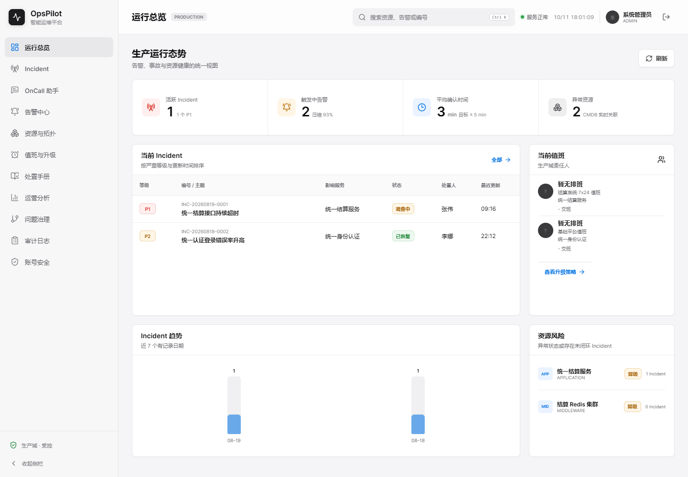
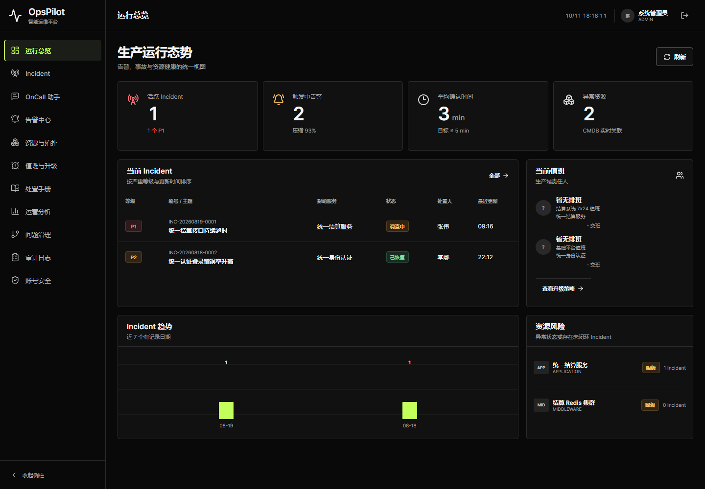
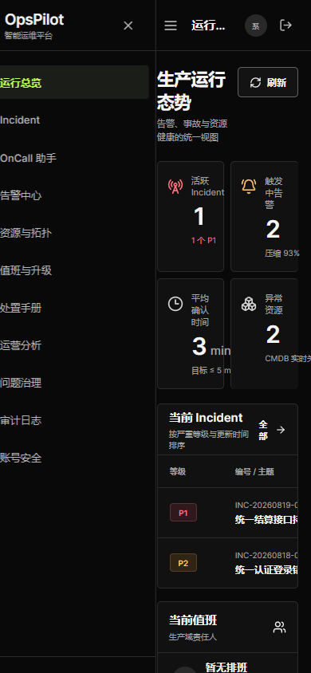

# V1.7 封版后的 OKX 风格 UI

2026-10-11。用户明确要求“先封版，然后优化 UI，风格参考欧易 OKX”。先将已验收 bb012bf 固定为 `opspilot-v1.7-sealed-20261011` 并上传，然后仅修改视觉层。业务 Java、V1–V42 迁移、配置、前端业务服务与 OnCall 组件共 216 文件的 Git 内容与封版一致。

## 交付范围

参考[OKX 官方页面](https://www.okx.com/zh-hans)实际截图的黑白高对比、主操作白底黑字和克制的状态色，不复制其品牌、交易内容或导航。保留 Vue、11 条业务路由、真实数据与所有权限/命令语义。统一全局导航、总览指标、表格、表单、详情、助手与登录页；基础样式中的硬编码颜色转为共享 token，新 `terminal.css` 定义终端主题和响应式布局。

移除原来没有功能的全局搜索和 Ctrl K、固定 PRODUCTION/“服务正常”/“生产域·受控”、登录页的伪趋势柱及固定“6 项核心资源在线”/认证运行正常断言。没有新增业务按钮、后端规则、渠道、迁移或自动化迭代任务。

## 设计与实现对照

frontend-app-builder 要求先生成完整概念图；imagegen 用于视觉参考，不作为运行时界面或数据来源。全部控件、图表与图标由 Vue/CSS/Lucide 原生实现。frontend-testing-debugging 用于真实浏览器验证；karpathy-guidelines 将改动限定在本次明确范围。

| 核对点 | 最终实现 |
| --- | --- |
| 黑白色阶 | 页面 #090909、面板 #111111、分隔 #2b2b2b、正文 #f5f5f5、次级 #a3a3a3；无装饰光晕 |
| 导航层级 | 216px 侧栏、64px 顶栏、11 条原路由；当前项仅用少量黄绿色，桌面折叠/手机抽屉可用 |
| 指标层级 | 4 个真实 API 指标，38px 等宽数字；null 仍为“-”，未伪造趋势/实时健康 |
| 工作区结构 | 上方 Incident 表格/当前值班，下方真实趋势/风险；保留原有数据与链接 |
| 状态及控件 | P1 红、警告琥珀、恢复绿；白色主按钮，灰边次按钮，可见键盘焦点；小屏两列指标及表格区域内横向滚动 |

差异 ledger：概念图误补了 5 个无记录日期、改变值班/风险表头及部分图标；实现没有采用这些虚构内容。趋势仍仅显示真实 08-19、08-18 两个记录。保留原 Lucide 图标，详情密度和字体适配原有复杂页面；不是像素级复刻。主视觉一致，文字/数据准确性优先。

copy diff：11 项导航和总览业务文案未增加；登录描述改为“告警关联、值班协作与处置审计”，提示改为“演示账号仅用于本地试用”。删除上述不真实状态与无功能文案，不添加交易、收费、用户量或营销宣称。

## 实际验证

目标流程：登录临时演示库 → 总览刷新 → 桌面折叠/展开 → 原 11 页面 → Incident 筛选/详情 → 人工读取通知运行状态 → 手机导航 → 退出登录。

Browser plugin 未安装，使用现有 Playwright 1.63 与 Chrome；没有安装新依赖。Vite `http://127.0.0.1:5181`、打包页面 `http://127.0.0.1:9911` 均在 **1440×1000 / 390×844** 下执行：22 页面检查、7 项交互通过，URL 路径/标题/非空内容/无框架覆盖层/无页面横向溢出成立。只读运行观察返回实际“未启用”，不发通知、重投、接班、审批或调查命令。

未解释的 JS 错误、控制台错误、HTTP 异常为 0。**不是原始控制台完全无错误**：新库尚无手册评测，既有 `/runbooks/evaluations/latest` 返回两次预期 404，原页面已处理为空状态，原始记录保留。首次进入无历史会话的助手会按原代码 POST `{incidentId:null}` 建立空会话；这是既有行为，不是只读请求或 AI 调查。首次整包检查发现该测试预期差异，调整判定后复测通过，不改生产代码。

前端 `npm test` **223/223**、`vue-tsc` 与 Vite 构建通过；可重复浏览器脚本 `scripts/browser/verify-ui-okx.cjs`。Maven `-DskipTests package` 成功，**本轮未重复跑完整 Java/MySQL/远端 CI**；后端证明仍指向封版受验源码，不能套用于声称新提交 CI 全绿。Windows 首次打包受测试 JAR 文件锁影响，关闭自己测试进程后重打成功，旧 JAR 独立备份未丢失。

最终整包另在专有 9913/9914 和新临时 H2 上验证：HTTP 200 的 HTML、favicon、CSS、JS 字节摘要与前端构建产物一致，实际登录/刷新/手机/退出成立；验证结束认证 shutdown 200、JVM 退出及端口释放。详见[整包 proof](../assets/v1.7-ui-okx/packaged-qa.json)和[完整浏览器结果](../assets/v1.7-ui-okx/compiled-qa-result.json)。

没有连接用户演示数据库、启动用户 MySQL、修改主 HEAD/分支/index 或 reset/恢复旧文件。既有 dirty、旧静态 bundle 和历史 Demo 保留。独立 UI 分支上传源代码、构建静态文件与证据，不移动封版标签；无 PR，无强推。分支不匹配已有 CI push 范围，本轮不宣称新远端 CI 完成。

## 运行与复核

本地新版包 `target/opspilot-v1.7-okx-ui.jar`：`java -jar target/opspilot-v1.7-okx-ui.jar`，`http://localhost:9900`。旧包备份 `target/opspilot-v1.7-sealed.jar`，SHA256 `714295510a343f5a8369cb252c0f79049859d1566369d6b979f94524cc875353`。二进制只留本地 target，不提交到 Git；源码克隆后按 README 构建运行。试用账号 admin / OpsPilot@2026，不用于生产。

浏览器复核必须指向**隔离的本地演示库**，不能生产：在安装已有 scripts/browser 锁定依赖后，设置 `OPSPILOT_UI_QA_BASE=http://127.0.0.1:9900`，执行 `node scripts/browser/verify-ui-okx.cjs`。报告与截图写入新的系统临时目录，不覆盖旧 Demo。建议后续交互调试安装 Browser plugin；本次已有 Playwright 证据不依赖它。

限制：只验证演示账号与上述桌面/手机流程，不冒称每种角色、全部弹窗、每个业务写操作或所有屏幕宽度全面验收。暗色模式是本次默认，没有增加主题切换。未实现的长期设想仍按封版记录排除，不再自动扩项。

## 截图与旧版对照

[全部证据及摘要](../assets/v1.7-ui-okx/manifest.json)；旧版本原有 docs/assets 不变。以下为实际渲染结果，概念图另外保存，不混为可运行页面。

旧版桌面：

新版最终整包桌面：

新版最终整包手机：

