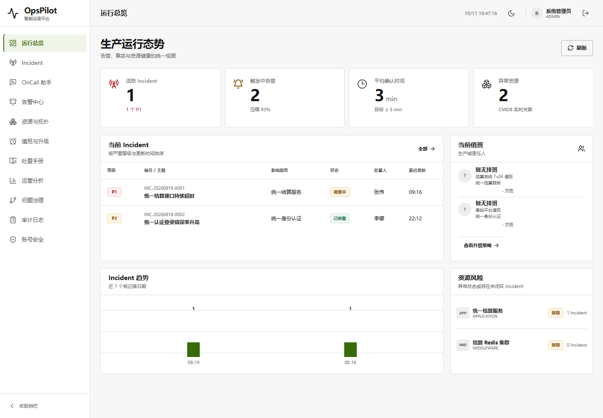
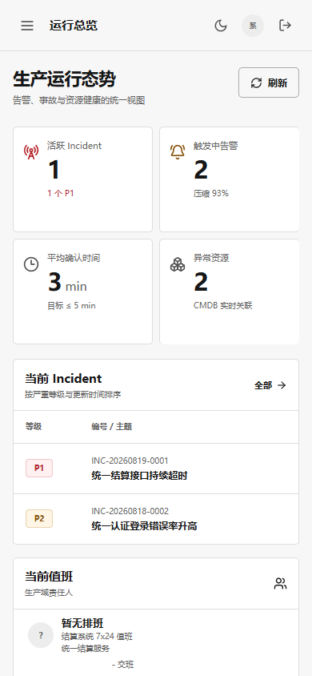
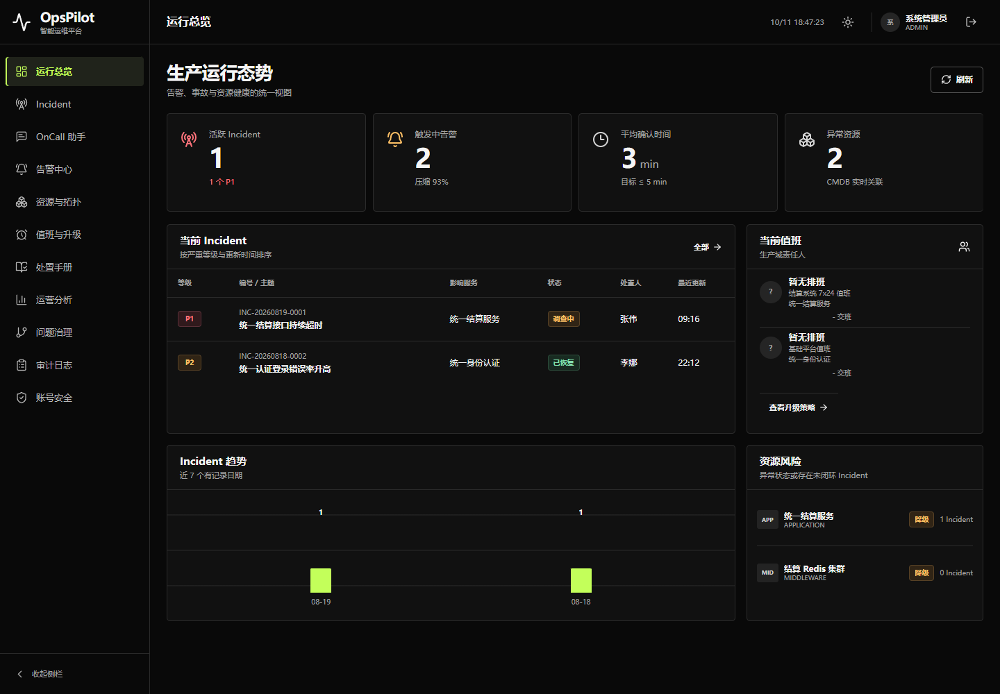
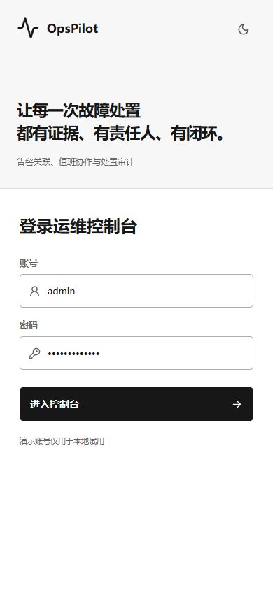

# V1.7 UI 增量：浅色主题与 Codex 字体

2026-10-11，仅响应用户“添加浅色主题，字体用 Codex 同款”。原[业务封版](../releases/V1.7-SEALED.md)与[OKX 深色 UI](V1.7-ui-okx.md)保留，不追加后端能力。

## 已实现

- 登录页与控制台顶栏增加太阳/月亮按钮，中文可访问名称支持键盘操作，手机上仍可见。
- 默认保留深色；浅色采用白色面板、浅灰画布、深色正文与深绿色当前项，状态含义不变。
- 只保存 `opspilot_theme`，刷新、路由切换、登录退出保留选择；存储失败时仍可在当前页切换。
- 首屏脚本先于样式与 Vue 执行，避免已保存的浅色先显示为深色。脚本使用已有匿名静态资源目录 `/assets/theme.js`，不放宽认证规则。
- 正文使用本机 Codex 默认系统字体栈，代码使用其默认等宽字体栈，无字体下载、第三方依赖或专有字体再分发。

## 字体依据

查阅 [OpenAI 官方外观设置](https://learn.chatgpt.com/docs/reference/settings)：UI/代码字体可自定义，因此不声称所有人的 Codex 都固定使用一种字体。本机安装包 `OpenAI.Codex_26.930.4958.0_x64` 的只读样式检查确认默认栈如下；只检查应用资源，没有读取聊天数据库或凭证。

```css
/* UI */
-apple-system-body, ui-sans-serif, -apple-system, system-ui,
"Segoe UI", "Helvetica", "Apple Color Emoji", "Arial", sans-serif,
"Segoe UI Emoji", "Segoe UI Symbol"
/* Code */
ui-monospace, "SFMono-Regular", "SF Mono", Menlo, Consolas,
"Liberation Mono", monospace
```

中文和拉丁字符的实际字体由操作系统回退决定，不能把字体栈中每个名字都说成已加载的字体。没有复制 OpenAI Sans 文件，也不把整个界面改为等宽字体。

## 验收进度

前端 `npm test`：231/231 通过（原 223 + 新 8）；`vue-tsc` 与 Vite 生产构建通过。开发服务器实页完成 11 路由 × 2 主题 × 2 视口检查，以及切换、刷新、登录、退出和手机导航。

发布检查发现初版 `/theme.js` 被现有认证拦截为 401，已改至 `/assets/theme.js`；第一次 QA 的 CDP 字体代理未启用和全局禁用存储导致既有认证初始化失败均属测试范围/夹具问题，已将存储失败验证限定到主题键，不修改既有认证实现。首次结果保留，不将失败写成通过。最终 JAR 验收结果在下一节追加。

业务 Java、迁移、配置、前端业务服务、原业务组件及 OnCall 页面 216 个既有文件相对上一 UI 提交 `b60629d` 的 Git 内容未变。主工作树未 reset/恢复，历史生成资源与旧 JAR 保留。

## 最终 JAR 实页验收：通过

测试流程：登录页键盘切换浅色 → 刷新保留 → 真实登录/刷新指标 → 11 页面在双主题与双视口渲染 → 手机菜单导航 → 退出并刷新仍保留浅色。另阻断 Vue 入口验证主题已先应用，并单独验证主题偏好存储报错不阻断切换。

环境：隔离 H2、本机 `http://127.0.0.1:9913`，1440×1000 与 390×844，现有 Playwright + Chrome。Browser 插件/skill 未提供，因此使用 Playwright；未安装新依赖，未连接用户数据库、AI 或真实通知渠道。

| 检查 | 结果 |
| --- | --- |
| 页面身份、非空、无框架错误覆盖层 | 44/44（11 路由 × 2 主题 × 2 视口）通过 |
| 整页宽度与截图 | 两种主题桌面/手机通过；Incident 表格保留局部横向滚动 |
| 字体 | 使用已核实的 Codex 默认栈；CDP 确认本机品牌文字实际渲染为 Microsoft YaHei UI，不是下载字体 |
| 文字/状态/按钮 token 对比度 | 32 项检查均 ≥ 4.5:1；不是对整个应用的完整无障碍认证 |
| 实际交互与主题记忆 | 6 条流程通过，包括键盘、刷新、登录退出、手机导航、首屏初始化和主题存储异常 |
| 页面/控制台/HTTP 错误 | 无新页面异常或非预期错误；无评估记录的既有 404 单列保留 |
| 业务写请求 | 除真实登录与助手首次访问原有的空会话创建，没有新增业务 POST |
| 打包资源 | index、favicon、新 CSS/JS、theme.js 均 HTTP 200 且 SHA256 与构建产物一致 |
| 关闭与隔离 | 验收 JVM 经认证正常关闭，验收端口释放，用户数据库未修改 |

最后一次测试修正只将 POST 观察范围限定为本站 `/api/`，避免把浏览器外部安全软件注入的会话请求误算为业务 POST；此前 44 页面与全部交互已通过，失败原始报告仍保留。没有为通过测试修改业务代码。

关键命令：`npm test`、`npm run build -- --outDir ../target/ui-themes-build`、`mvn -DskipTests package`，以及临时 Playwright 脚本的 `goto → click/Enter → reload → assert → screenshot`。构建输出复制时不清空原静态资源。

证据：[完整浏览器结果](../assets/v1.7-ui-themes/qa.json)、[整包 HTTP/关闭结果](../assets/v1.7-ui-themes/package.json)、[摘要与旧 Demo 校验](../assets/v1.7-ui-themes/manifest.json)。本地新包 `target/opspilot-v1.7-ui-themes.jar` SHA256：`ba157b2888e17046d342d79b0e8bd49ed1e4f2d110f1e984add7604dd89fb412`。原封版包与原 OKX 包摘要均未变。

### 发布边界

沿用 `ui/opspilot-okx-20261011` 上传有限的主题源码、构建资源及本报告证据，不切换主分支，不改主索引，不 force push，不改工作流。该 UI 分支不在现有 CI push 过滤器内，因此这里报告的是本轮本地测试与实际 JAR 验收，不声称新增远端 CI 已通过。

未覆盖 Safari/Firefox、其他视口、完整业务回归或 Codex 用户自定义字体；本轮 Java 测试没有重跑，打包明确跳过测试。主题偏好存储报错与全局认证存储禁用不同，不声称后者已支持。可在后续实页调试时安装 Browser 插件获得应用内浏览器能力；本次交付不依赖它。

### 截图





