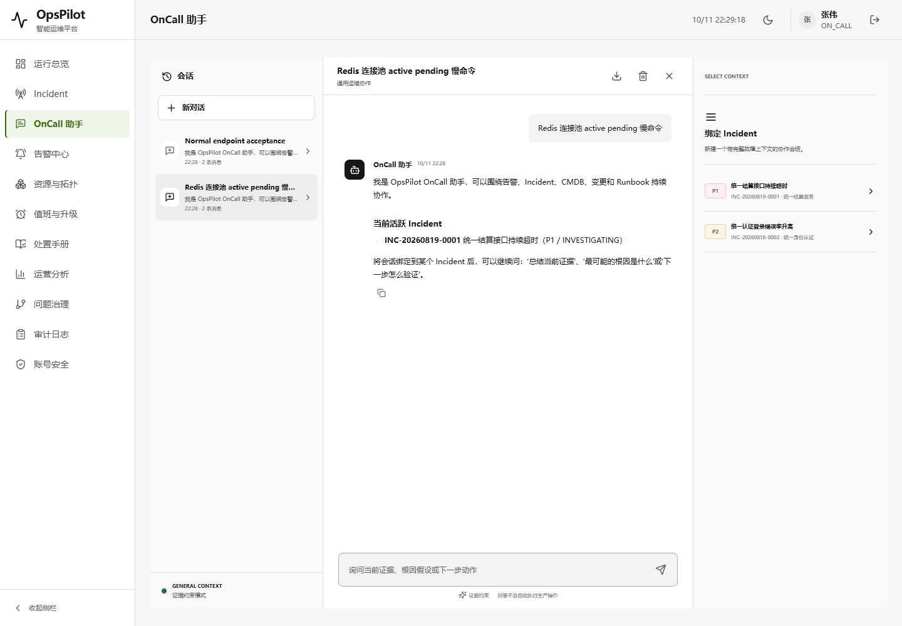
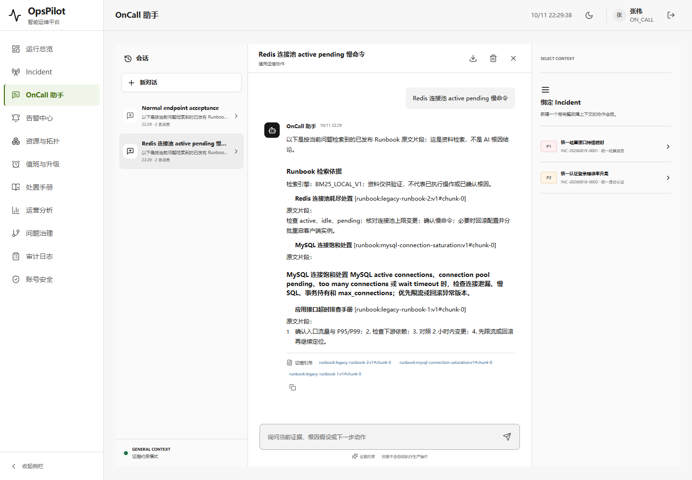
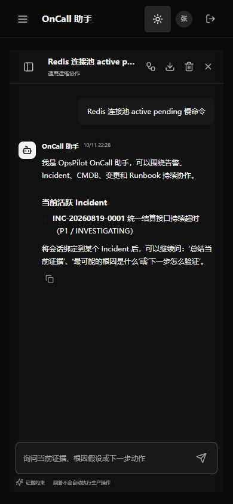
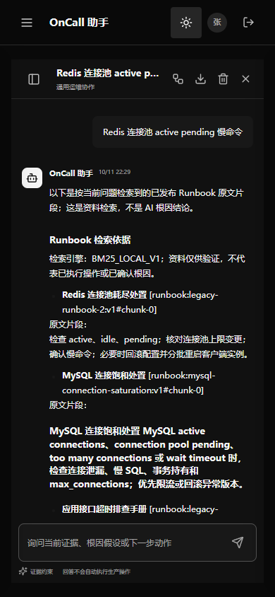

# V1.8 CP01：助手按问题检索 Runbook（封版后独立增量）

2026-10-11，用户明确回复“继续吧”后恢复限定业务迭代。本次只补差异审计中的“助手按用户问题检索知识库”，不是继续扩展整个原版 Agent 工具集，也不改变 V1.7 封版标签。

## 实现边界

- 正常回答与原生 SSE 共用一次 AUTO 检索，复用现有已发布文档、角色 ACL、BM25 / 可用时 Hybrid RRF，不引入新索引或迁移。
- 从当前数据库读取 ACTIVE 账户及原 lease 的 auth_version 对应角色，不把失效账户默认成 ON_CALL。AUDITOR 等不支持的角色保留原助手能力，明确不执行 Runbook 检索，不提升权限。
- 最多 3 个片段，片段上限沿用检索服务 600 字。消息上限仍为 10000 字；检索使用前 500 字以内的 Unicode 安全前缀。完整问题、幂等内容绑定不改变，规则回答明确提示前缀预算，模型上下文保留实际 query。
- 引用使用现有 `runbook:<stableKey>:v<version>#chunk-<index>`，作为 RUNBOOK 类型证据与答案一同持久化。Incident、告警、变更、调查证据保留。
- AI 未启用或正常模型调用失败时返回真实检索片段，不假装 AI 推理；无结果明确未命中。模型提示把资料及历史标为数据而非指令，不能把 Runbook 当作已确认根因；不增加自动执行工具。
- 原生流保留模型输出原字节语义，不在预览后偷偷追加未发送文本；引用在完成事件 evidenceJson 中返回。正文是否正确引用仍需真实模型评测，不宣称彻底消除幻觉。
- 完成键只读回放原答案/原版本，不再检索。新问题才查询当前已发布版本。对话是用户私有的历史快照，不是文档实时视图；本次不新增历史答案随文档下架/ACL 变化追溯擦除能力。
- 原取消、预算、撤权及完成事务围栏保持；检索前后检查原 checkpoint/lease，不在外部检索/模型调用期间持有账户或会话锁。取消可能留下独立检索遥测，但不能提交完整答案，遥测不是回答完成证明。

## 第一阶段验证

实际执行 90 项，0 failures / 0 errors / 0 skipped，日志 `target/assistant-rag-tests.log`：

| 测试 | 执行数 | 证明范围 |
| --- | ---: | --- |
| AssistantRunbookIntegrationTest | 10 | 实际 H2 检索、发布/ACL、无匹配、前缀预算、版本/键回放、取消、模型两路径上下文与撤权、绑定 Incident |
| AssistantAiStreamingTest | 14 | 新增两路径提示边界；原流协议/字符/帧上限回归 |
| AssistantTransactionIntegrationTest | 11 | 答案/标题/审计/键完成事务及并发取消/撤权 |
| AssistantSessionRevocationIntegrationTest | 32 | 原同步/流式会话撤权等回归 |
| AssistantNativeEndpointIntegrationTest | 18 | 本机受控模型 HTTP 原生流、停止与持久化回归，无真实付费调用 |
| RunbookKnowledgeIntegrationTest | 5 | 原知识库导入、检索、权限和评测回归 |

首轮暴露 AUDITOR 无 Runbook 权限使助手失败，已限定捕获 `RUNBOOK_ROLE_UNSUPPORTED`，不捕获其他检索故障、不默认提高角色。修复后以上 90 项完整重跑通过；未修改既有事务场景来迁就实现。

## 第二阶段：实际整包及浏览器验收通过

旧 `opspilot-v1.7-ui-claude.jar` 与新 `opspilot-v1.8-assistant-runbook.jar` 各使用一个全新临时 H2，在 `127.0.0.1:9913` / 管理端口 9914 顺序运行，不连接用户数据库。AI、外部通知及后台业务发送均关闭。Browser plugin 未提供，按 frontend-testing-debugging skill 使用既有 Playwright 1.63.0 / Chrome，没有安装依赖或修改 UI。

验收流：真实登录 `zhangwei` → 通用助手会话 → 页面发送相同问题 `Redis 连接池 active pending 慢命令` → 消费真实 SSE → 核对持久化答案/引用 → 同键正常端点回放 → 新会话正常回答 → 刷新 → 1440×1000 浅色与 390×844 深色截图。

| 检查 | 旧 Demo | 新 Demo |
| --- | --- | --- |
| 页面路由/会话参数/标题、非空及无框架报错覆盖层 | PASS | PASS |
| 浏览器异常、console error/warn、HTTP >=400 | 无 | 无 |
| 同问题回答 | 通用 Incident 引导，0 个 Runbook 引用 | 真实 Runbook 片段，3 个版本化候选引用 |
| 首个引用 | 无 | `runbook:legacy-runbook-2:v1#chunk-0` |
| 正常端点与 SSE 答案/引用一致 | PASS | PASS |
| 同键回放原 messageId/答案/证据、回放响应头 | PASS | PASS |
| 刷新后答案/引用保留，桌面/手机无页面横向溢出 | PASS | PASS |
| 认证关闭进程、退出码 0、两端口释放、输入 JAR 未变 | PASS | PASS |

两个 JAR 提供的 5 个入口/主题/JS/CSS 资源 SHA256 完全相同，本次只有后端回答内容改变；OKX 布局、双主题、Codex 字体保留。新 JAR SHA256：`81a01f9f5b855b79ad3a5e860941d12bc278c45859a4bbb36030df2564846c4d`。4 个历史 Demo 按旧清单复核不变，详情见 [proof.json](../assets/v1.8-assistant-runbook/proof.json)。本机 `target` 产物不上传 Git，clone 后需要自行构建，不能把 GitHub 分支误当 JAR 下载项。

证据：[90 项 JUnit 汇总](../assets/v1.8-assistant-runbook/java-results.json)、[实际整包浏览器结果](../assets/v1.8-assistant-runbook/qa.json)。首次整包脚本经历 3 次采集/断言适配失败：正常 session 参数、Chrome 不保留 SSE 的 Network response body、USER/ASSISTANT 共用复制按钮标题；分别见 [attempt 1](../assets/v1.8-assistant-runbook/qa-harness-attempt-1.json)、[attempt 2](../assets/v1.8-assistant-runbook/qa-harness-attempt-2.json)、[attempt 3](../assets/v1.8-assistant-runbook/qa-harness-attempt-3.json)。没有为通过脚本修改页面或产品行为；最终通过轮观察原始 fetch Response 的 clone，不替换服务端响应。此前进程均已安全关闭、端口释放。

## Git 交付与未验边界

独立业务分支：[work/opspilot-assistant-runbook-20261011](https://github.com/Trigger726/OnCall-Agent/tree/work/opspilot-assistant-runbook-20261011)，从 UI 审计提交 `4552c1242bd0aba5d38932104148f3be6ddd71ef` 增量提交。只包含本项源码、测试、可复验入口、当前状态说明及证据；使用独立 Git index，不切换/重置当前 dirty 分支，不覆盖主 index、不 force push。V1.7 封版 tag、原版 archive、WIP 与 UI 分支保持固定。

本轮没有触发/宣称新的远端 CI 全绿，也没有重跑完整 MySQL/迁移矩阵、付费云模型或生产流量。现有 Hybrid 可用时接入逻辑被复用，但本轮整包默认关闭语义模型，实际效果证明仅为 BM25 模式及受控模型协议。3 条结果是检索候选，不意味着全部精确相关；不把本轮完成等同于完整长期目标 100%。

karpathy-guidelines 将改动限定为复用检索的单条助手链路；frontend-testing-debugging 要求真实交互及新旧截图对照，推动保存可重复入口，而非仅凭编译结果验收。

## 复现命令

使用本机 JDK 21 / Maven 3.9.16（项目编译目标 17），既有 Maven 本地仓库，无新增依赖：

```powershell
& 'D:/tools/apache-maven-3.9.16/bin/mvn.cmd' -o '-Dmaven.repo.local=D:/Codex/国网/tmp/m2-repository' '-Dtest=AssistantRunbookIntegrationTest,AssistantAiStreamingTest,AssistantTransactionIntegrationTest,AssistantSessionRevocationIntegrationTest,AssistantNativeEndpointIntegrationTest,RunbookKnowledgeIntegrationTest' test
```

相关测试通过后执行 `mvn package -DskipTests`；本次为实际 90 项测试之后打包，不把打包时 skipTests 计作测试通过。保留旧 JAR，再将生成的 snapshot 复制为未存在的新 Demo 名称，不能覆盖上述 4 个旧 Demo。

在仓库根目录运行完整对比入口（需 `JAVA_HOME`、既有 `scripts/browser/node_modules/playwright` 和 Chrome）：

```powershell
node scripts/verify-assistant-runbook-packaged.cjs --before target/opspilot-v1.7-ui-claude.jar --after target/opspilot-v1.8-assistant-runbook.jar
```

脚本固定使用独占 loopback 9913/9914，有占用则停止，不接管他人的服务。每个版本使用独立临时目录/数据库，执行会在该临时数据中创建测试会话、发送问题及产生审计记录；不是对用户数据执行只读检查。截图、运行 JSON、后端日志保存到 `%TEMP%/opspilot-assistant-rag-*`，不覆盖 JAR、不反向迁移已有数据库。

## 截图

顺序为旧版桌面、新版桌面、旧版手机、新版手机；同问题、同 UI 资源、独立新数据库。新版手机长答案在消息区域纵向滚动，截图为首屏，不冒充全量片段都在一屏展示。





