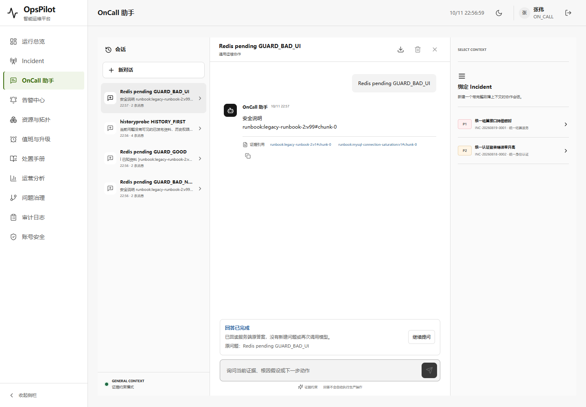
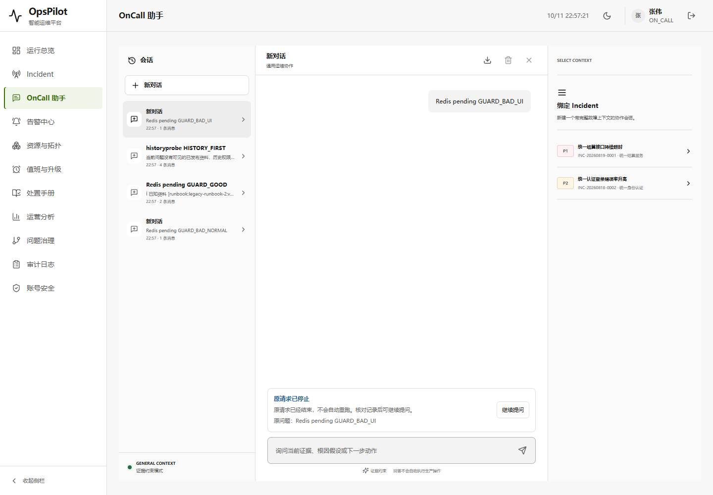
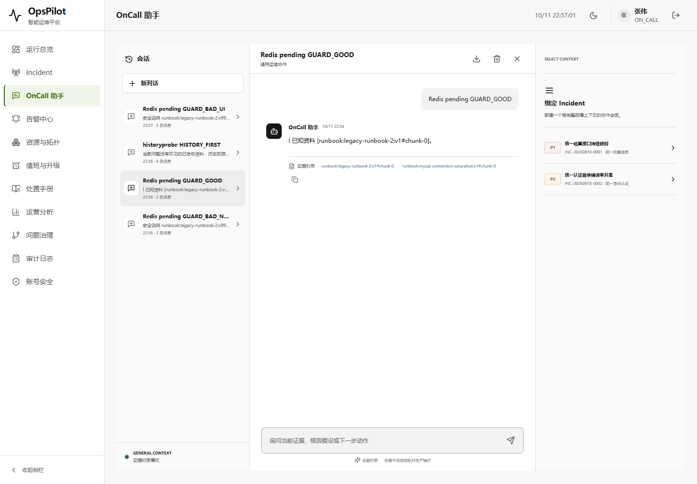
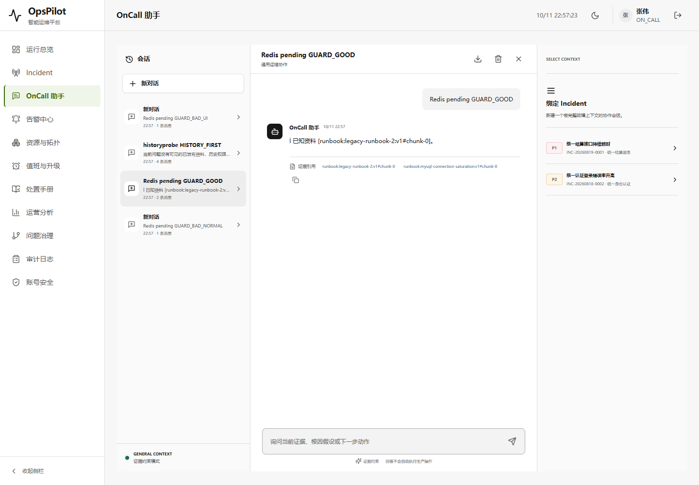
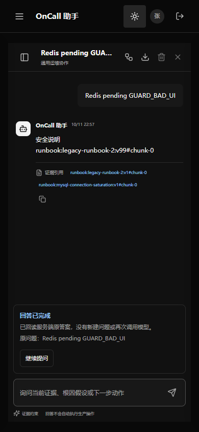
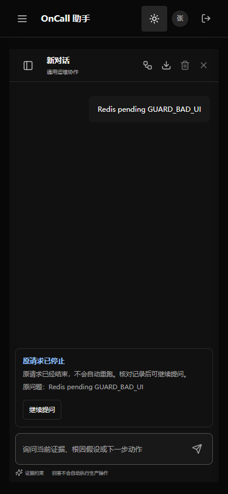

# V1.8 CP02：模型引用围栏与历史上下文权限

2026-10-11，接续 [CP01](V1.8-checkpoint-01-assistant-runbook.md) 的真实 RAG 链路。本轮补强该链路，不扩展天气/手册/任意模型工具，也不修改 V1.7 封版或旧 Demo。

## 第一阶段：实现与 102 项相关回归通过

当前源码确认两项风险：正文引用只受提示词约束；已保存的助手回答无条件重入新模型上下文。原始归档 ChatService 的 buildSystemPrompt 也直接拼接历史，不将原版的存在当成当前权限/引用可靠性的证明。

- 新 `AssistantCitationGuard` 只允许模型打印本次检索实际返回的完整 Runbook citation。未知文档、版本、chunk、畸形引用或追加伪后缀返回 `ASSISTANT_CITATION_INVALID`，正常回答不会绕到规则模式伪装成功，不提交助手答案/完成审计/COMPLETED 键。
- 原生 SSE 保留文本总内容及 Unicode，逐步输出非引用文字；引用前缀跨帧时先保留，待完整合法边界/正常结束才释放。未知引用不会被输出，但此前合法非引用预览不能撤回。失败时不发送完成答案，沿用原停止/FAILED 语义，不偷偷重试模型。
- 仅在新模型调用前，按当前 ACTIVE 用户、原 lease auth_version、角色 ACL 和 PUBLISHED 状态核对旧助手证据；任一 Runbook 引用当前不可见则整条旧回答使用明确占位说明，防止混合消息只擦引用却留下敏感正文。坏证据 JSON 同样不成为模型上下文。
- 可见且仍已发布的旧回答保持；USER 原问题/用户主动粘贴内容不做追溯擦除。私有历史会话、导出、已完成键的原版本回放仍按 CP01 快照语义保留，不删改数据库原文。该功能不是实时收回已发送字节或抹除用户已知信息。
- 本次白名单校验只证明引用来自本轮检索，不证明引用与结论语义匹配，更不证明日志、指标、根因或操作真实。未引用的事实幻觉、Runbook 片段里的引用文字仍须独立评测；默认规则模式明确显示原文片段，不冒充模型结论。

实际执行：102 tests、0 failures / errors / skipped，日志 `target/assistant-grounding-tests.log`。新增 6 项引用解析测试（逐分割点循环，不把循环次数算 JUnit 数量），现有 AssistantRunbookIntegrationTest 扩为 16 项。原生 HTTP 18、撤权 32、事务 11、AI 流 14、Runbook 知识库 5 项一并通过。

新增场景覆盖：正常模型伪引用失败不落库、跨帧伪引用不下发、跨帧真引用保持原文/落库一致、角色降级后的历史上下文过滤、ACL/发布状态变化过滤但原快照保留、仍可见的已发布历史不过度过滤。

## 第二阶段：真实 SDK / TCP / 发布 / 浏览器整包通过

旧 CP01 JAR 与新 `target/opspilot-v1.8-assistant-grounding.jar` 顺序运行，各使用独立新临时 H2。HTTP 模型只接本机随机端口的受控 DashScope 兼容端点，通过真实 SDK 调用/原生流，不使用生产密钥、付费 AI 或用户数据库。业务/管理固定 loopback 9913/9914，均先检查独占；后台发送和语义模型关闭。

实际每版 5 次模型调用，共 10 次：正常伪引用、跨帧合法原生引用、历史首次回答、独立发布后追问、页面伪引用。正常/原生流的服务端运行状态和 message 内容均通过认证 HTTP 回读，不以页面外观推断是否落库。

| 实际场景 | CP01 原 Demo | CP02 新 Demo |
| --- | --- | --- |
| 受控模型引用不存在的 v99 | HTTP 200 / COMPLETED，正文已保存 | HTTP 502 / `ASSISTANT_CITATION_INVALID` / FAILED，没有助手答案 |
| 页面原生流伪引用跨帧 | 输出 v99，发送 done | 只输出合法非引用预览，不输出 `runbook:` 或 done，停止后回读 FAILED |
| 页面查询原请求 | 完成回答可见 | “原请求已停止”，原问题仍在，没有伪引用助手消息 |
| 合法 v1 引用跨帧及 Unicode | 正常完成 | 正常完成，原生文本拼接=持久化原文，页面能回读合法引用 |
| admin 导入/lina 独立发布 v1 给 ON_CALL，再发布 v2 仅给 ADMIN/OPS_MANAGER | 后续模型上下文仍包含旧 v1 正文标记 | 当前检索无可见结果；历史用占位说明替换，不含旧正文标记 |
| 完成键回放/私有对话导出 | 原 v1 快照保留 | 原 v1 快照保留，不把历史擦除冒充权限过滤 |
| 两个 JVM、受控模型端口、输入 JAR | 正常关闭/端口释放/摘要未变 | 正常关闭/端口释放/摘要未变 |

页面流程：真实登录 → 指定新会话 → 发送同一伪引用问题 → 实际 SSE → 新版显式查询原请求 → 桌面 1440×1000 浅色 / 手机 390×844 深色截图 → 刷新核对未保存伪答案 → 回读另一会话的合法原生答案。路由/标题/非空/无框架覆盖层通过，浏览器 console error/warn、pageerror、HTTP >=400 均为空；预期的正常端点 502 由独立 HTTP 客户端核验，不冒充浏览器异常。

按 frontend-testing-debugging skill，Browser plugin 缺失时使用现有 Playwright / Chrome；未安装依赖、未修改 UI。旧/新 JAR 的 5 个 UI 静态资源摘要一致，保留 OKX 双主题和 Codex 字体。karpathy-guidelines 将生产改动限定为同一问答链路，不引入新数据库迁移或模型工具。

证据：[102 项 JUnit 汇总](../assets/v1.8-assistant-grounding/java-results.json)、[真实整包结果与模型上下文观察](../assets/v1.8-assistant-grounding/qa.json)、[来源/6 个 JAR/静态资源/截图 SHA256](../assets/v1.8-assistant-grounding/proof.json)。新 JAR SHA256：`69e59fa5ded26dd67c07290d5891c6d25869e81410516cd4943c66f250202efd`。5 个历史 Demo 复核未变，本机 target 产物不上传 Git，clone 后须自行构建。

整包脚本首 3 次有适配断言失败，均保存：[错误封装在 error.code](../assets/v1.8-assistant-grounding/harness-attempt-1.json)、[FAILED 的既有页面标签是“原请求已停止”](../assets/v1.8-assistant-grounding/harness-attempt-2.json)、[脚本初始化在刷新时已选择浅色，无需再点击浅色切换](../assets/v1.8-assistant-grounding/harness-attempt-3.json)。没有为通过脚本更改产品或删除失败记录；最终完整通过轮使用真实响应 clone 观察 SSE，不伪造/替换网络响应。

## 交付及复验

在原独立业务分支 [work/opspilot-assistant-runbook-20261011](https://github.com/Trigger726/OnCall-Agent/tree/work/opspilot-assistant-runbook-20261011) 从 CP01 `a5b6dde` 增量交付。仅本轮生产代码/测试/验收入口/当前状态与证据；独立 index，不切换 dirty 工作区、不改主 index、不 force push。V1.7 tag、原始 archive、WIP 和 UI 分支不动，CP01 及历史报告按原证据保持。

复验使用 JDK 21 / Maven 3.9.16（项目编译目标 17），现有仓库和依赖：

```powershell
& 'D:/tools/apache-maven-3.9.16/bin/mvn.cmd' -o '-Dmaven.repo.local=D:/Codex/国网/tmp/m2-repository' '-Dtest=AssistantCitationGuardTest,AssistantRunbookIntegrationTest,AssistantAiStreamingTest,AssistantTransactionIntegrationTest,AssistantNativeEndpointIntegrationTest,AssistantSessionRevocationIntegrationTest,RunbookKnowledgeIntegrationTest' test
node scripts/verify-assistant-grounding-packaged.cjs --before target/opspilot-v1.8-assistant-runbook.jar --after target/opspilot-v1.8-assistant-grounding.jar
```

整包入口需设置 `JAVA_HOME`，既有 `scripts/browser/node_modules/playwright` / Chrome。会在两份**临时数据**里导入、独立审批、替换测试 Runbook、创建会话和产生审计记录，不是对用户数据只读。它只消费已有 JAR，不重建/覆盖 Demo，不回退已有数据库；输出目录 `%TEMP%/opspilot-grounding-*`。任何端口已有服务则停止，不接管他人进程。

本轮不是原版接口或全部语料 A/B、真实模型的引用语义质量/抗提示注入测评、MySQL 或全 CI 重跑，更不是生产效果或整个长期目标完成。当前权限检查是新模型调用前的可见性，不实时擦除已授权保存的原答案，也不能撤回已发给模型的字节；未证明跨机器运行、并发 publication 变化时的所有线性化边界。

## 截图

顺序：旧版接受 v99、新版拒绝并回读停止、旧版合法引用、新版合法引用、旧版手机、新版手机。







