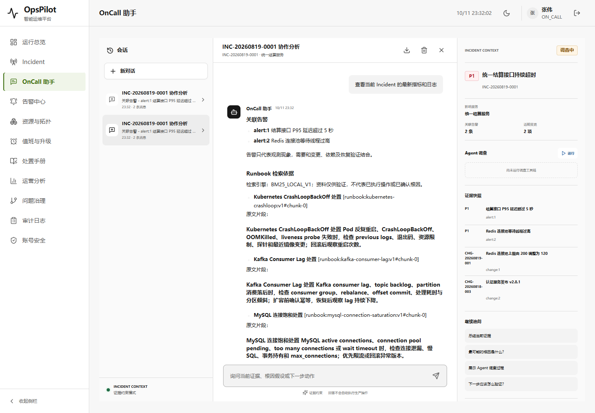
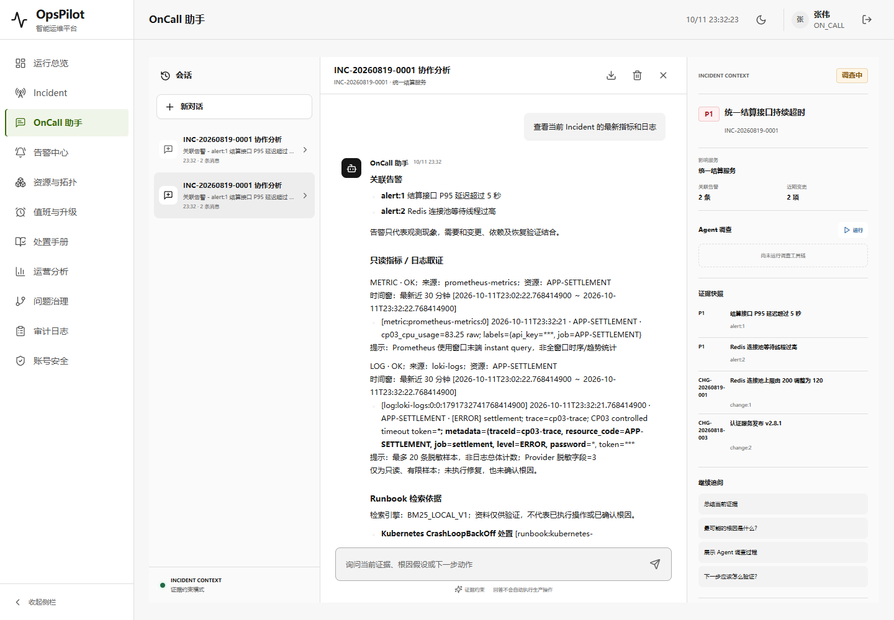
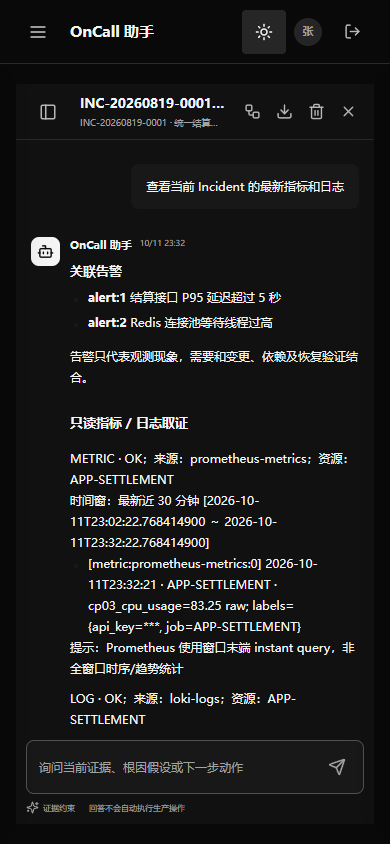
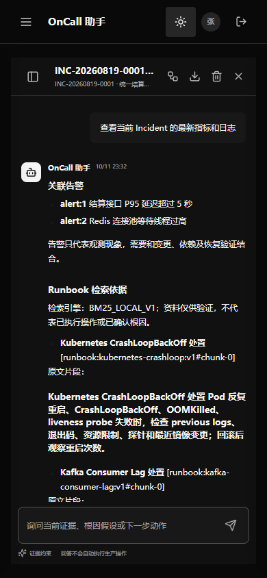

# V1.8 CP03：普通助手的真实指标与日志取证

2026-10-11，接续 [CP02](V1.8-checkpoint-02-assistant-grounding.md)。原始 OnCall 的指标/日志工具作为能力基线；本轮只补既有助手的只读取证链路，不开放任意模型工具，不移动 V1.7 封版或覆盖历史 Demo。

固定归档 `0cd654e` 的 `QueryMetricsTools` 实际查询 `/api/v1/alerts` 活动告警，`QueryLogsTools` 有模拟数据、非 mock 分支提示依赖 MCP；本轮复用 OpsPilot 已有 `/api/v1/query` 指标快照与 Loki `query_range`，不宣称原工具名/API/CLS 协议等价，也未重跑原版。它补的是原项目的运维问答能力方向，不是伪称所有旧接口兼容。

## 第一阶段：实现与 121 项相关回归通过

已确认：普通助手遇到“指标”只返回关联告警；调查 Agent 已有 Metrics/Logs Provider，但助手未调用。本轮实现以下限定行为：

- 从会话绑定的 Incident / CMDB 建立范围，复用 Provider 路由；用户文本不能指定资源、PromQL 或 LogQL。未绑定先要求绑定，AUDITOR 不访问 Provider，普通 Runbook 问答不额外取证。
- 默认复用 Incident 故障窗口；明确最新/当前/实时则近 30 分钟。被识别的“最近/近/过去/last/past + 数字分钟/小时/天”除 30 分钟外，以及昨天/今天/前天/ISO 日期暂不支持并明确不查询；不把种子历史数据说成实时。关键词路由不是完整自然语言时间解析器。
- 指标和日志各最多 20 项，排除窗口外样本；来源、观测时间、窗口与脱敏文本保存在每条 evidence 的可选 snapshot 字段。旧三字段证据仍能读取，无数据库迁移。
- 正常回答与原生 SSE 共用快照/模型上下文和实际引用白名单。正常无模型模式显示实证及边界，AI 模式说明证据是数据不是指令。引用有效不证明结论正确，提示词也不是事实准确性保证。
- 区分未请求、无范围、无权限、范围不支持、EMPTY 和 FAILED；降级和有限样本告知，不把查询失败或空样本说成系统健康。Prometheus 现有接口是窗口末端 instant query，不冒充完整时序/趋势。
- Provider 尝试前及返回后重查原 checkpoint / lease / 运维角色；备用 Provider 之前的取消检查在 router catch 外。取证后模型调用与最终事务再围栏，外部网络不占行锁。已经在途的同步 Provider 仍受其原连接/读取超时约束，不声称能撤回已发字节。
- 新模型调用时，角色降级后旧 METRIC / LOG 回答整条隐藏；原私有历史、导出及已完成键快照仍保持。历史快照与实时查询明确区分，不追溯抹除用户已知内容。

karpathy-guidelines 将改动限定于已有助手和两条路由的可选 checkpoint，旧调用保持无参数行为。frontend-testing-debugging 将用于实际登录、SSE、回读、桌面/手机与浏览器健康；Browser plugin 不可用，使用项目已有 Playwright / Chrome，不安装依赖。

JDK 21 / Maven 3.9.16 本地实际执行 121 tests，0 failures / errors / skipped，日志 `target/assistant-observations-tests.log`。新增取证集成 15 项、引用测试增加 1 项（逐帧分割循环不算更多 JUnit 数量）；Runbook 助手 16、AI 流 14、原生 HTTP 18、撤权 32、事务 11、Runbook 知识库 5 与三个原 Provider 测试均通过。模型使用受控 mock；实际 Local Provider / H2 种子故障窗口、脱敏与持久化也经过集成验证，不把 mock 当真实云模型。

新增测试覆盖：Incident 范围不受问题中的假资源/表达式影响、最新窗口、未绑定/角色/不支持范围不取证、陈旧与未来样本排除、20 项预算、空数据与失败区分、降级来源、取消阻止备用 Provider/日志/模型、查询中角色降级、幂等回放不取证、正常/原生的共同证据与真/伪引用、历史角色降级过滤及原快照保留、模型返回后撤权不落库。两次独立 Runbook 检索的 searchId 不同，比较上下文时仅归一该 ID，实际取证快照严格一致。

首轮 121 项有 2 failures / 3 errors，失败不删除：[新增套件原始 XML](../assets/v1.8-assistant-observations/java-attempt-1.xml)，完整首轮日志本机 `target/assistant-observations-tests-attempt-1.log`。其中一个实际缺陷是英文 `unknown` 被子串 `now` 错判为最新，已改为英文单词匹配；其余为重设 Mockito 回调触发旧回调 NPE 和独立 searchId 比较错误，修测试后重跑上述完整 121 项，不压低断言以掩盖生产错误。

## 第二阶段：真实 Provider / HTTP / 浏览器旧新整包通过

旧 CP02 `target/opspilot-v1.8-assistant-grounding.jar` 与新 `target/opspilot-v1.8-assistant-observations.jar` 顺序运行，各使用独立新临时 H2；均关闭 AI、语义模型与后台投递。真实 Prometheus/Loki 客户端接本机受控 HTTP，分别校验 CMDB 固定表达式、末端时间与 20 条上限，非 stub Provider、不是生产监控集群。旧版 0 次外部取证，新版 8 次（页面最新 2、正常最新 2、空数据 2、故障窗口 503 后降级 2）。测试将 Provider 内部重试上限设为 1；生产现有可靠性配置未改变。

| 相同/边界场景 | CP02 旧 Demo | CP03 新 Demo |
| --- | --- | --- |
| 登录后绑定 Incident，问“查看当前 Incident 的最新指标和日志” | 关联告警及 Runbook，没有取证调用 | 实际 `cp03_cpu_usage=83.25` 和受控 timeout 日志，来源、观测时间、近 30 分钟、instant 边界可见 |
| SSE / 数据库原答案 | 原规则回答一致 | 实际 delta 拼接=保存原文；METRIC / LOG 各一条带脱敏 snapshot |
| 同键正常端点回放 | 原快照保持 | 完全原快照、replay header=true，零新增 Provider 调用 |
| 新键正常端点 | 无新取证 | 新一轮 2 次 Provider 调用，同样真实来源；时间随新请求变化，不强称文本逐字相等 |
| 未绑定 / AUDITOR / 过去 24 小时 | 原版无取证 | 明确未执行原因，零取证调用 |
| 窗口内无返回 | 本轮未对旧版额外查询 | 两类 EMPTY，不代表系统健康，不虚构零故障 |
| 两外部来源 503，故障窗口 | 本轮未对旧版额外查询 | 显示两项 unavailable 提示及真实 local 来源，历史 pending=84；明确不是实时，种子 token 已脱敏 |
| 桌面浅色 / 手机深色、刷新 | 通过 | 通过；5 个 UI 静态文件与旧版完全一致 |

实际页面流程：Chrome 真实登录 → 认证 API 创建绑定会话 → 页面选择会话 → 输入同问题并点击发送 → 真实 SSE → 认证 GET 核对原答案/证据 → 原键回放 → 新会话正常端点 → 刷新原页面 → 1440×1000 浅色 / 390×844 深色截图。两版路由/标题/非空/无框架覆盖层通过，console error/warn、pageerror、HTTP >=400 均为空，无横向溢出。SSE 只观察真实 Response.clone，不替换网络或页面响应；已逐张检查桌面前后与新版手机截图，值、脱敏和窗口可读，长内容在既有消息容器滚动。

证据：[121 项 JUnit 汇总](../assets/v1.8-assistant-observations/java-results.json)、[真实 Provider 请求/页面/回放/降级结果](../assets/v1.8-assistant-observations/qa.json)、[原归档来源、源码、7 个 JAR 和静态资源 SHA256](../assets/v1.8-assistant-observations/proof.json)。新 JAR SHA256：`c56db7156f1278b519876759ead4a564d07cb1fb8ddcfc45de2e8d847581f856`。六个历史 Demo 哈希未变；target 产物不上传 Git，clone 后须构建。两个 JVM 正常管理关闭、loopback 9913/9914 和受控 Provider 端口均释放，无用户数据库改动。本轮整包首次即通过，补充受控 Provider 断言异常捕获/清理保护后再次完整通过，证据采用第二次最终脚本运行，每版调用数按该轮统计；首轮 Java 失败按上节保留。

## 交付与复验

继续独立业务分支 [work/opspilot-assistant-runbook-20261011](https://github.com/Trigger726/OnCall-Agent/tree/work/opspilot-assistant-runbook-20261011)，以 CP02 `2d22f44` 为父提交增量交付。独立 Git index，仅加入本轮代码/测试/验收与当前入口，不切换 dirty 工作区、不改主 index、不 force push。V1.7 标签、archive、WIP、UI 分支与已有报告不动。

```powershell
$env:JAVA_HOME='C:/Program Files/Java/jdk-21'
& 'D:/tools/apache-maven-3.9.16/bin/mvn.cmd' -o '-Dmaven.repo.local=D:/Codex/国网/tmp/m2-repository' '-Dtest=AssistantObservationIntegrationTest,AssistantCitationGuardTest,AssistantRunbookIntegrationTest,AssistantAiStreamingTest,AssistantTransactionIntegrationTest,AssistantNativeEndpointIntegrationTest,AssistantSessionRevocationIntegrationTest,RunbookKnowledgeIntegrationTest,LogsProviderRouterTest,PrometheusMetricsProviderContractTest,LokiLogsProviderContractTest' test
node scripts/verify-assistant-observations-packaged.cjs --before target/opspilot-v1.8-assistant-grounding.jar --after target/opspilot-v1.8-assistant-observations.jar
```

整包脚本仅消费已有 JAR；需现有 Playwright / Chrome。会在两份临时数据创建会话、问题、审计和请求状态，输出 `%TEMP%/opspilot-observations-*`。原数据库只读/不接触，不在已有库反向迁移。已有端口占用即拒绝，不接管其他进程；后台所有子进程是脚本自己启动的。

限制：本轮没有 MySQL、真实云模型/生产监控集群或全 CI 证明；只验证本机受控协议和 Windows Chrome 两个 viewport，不代表所有浏览器/生产质量。引用白名单不是内容与结论的语义匹配校验；AI 文字未宣称必然披露所有边界，规则模式与快照具备实际证据。脱敏复用原字段/IPv4/邮件规则，不是任意敏感内容 DLP。同步 Provider 在途请求及内部重试沿用其连接/读取超时，不证明即时中断内部重试或撤回已发送字节。故障窗口沿用创建前 30 分钟至更新时间后 30 分钟，可能宽于最新窗口；不支持任意 PromQL/LogQL/资源/时间范围与完整趋势统计。本轮是已验增量，不是整个长期目标完成。

## 截图

顺序：旧版桌面仅告警/手册、新版桌面实证、新版手机实证、旧版手机。UI 样式未改，只对比新增业务效果。





