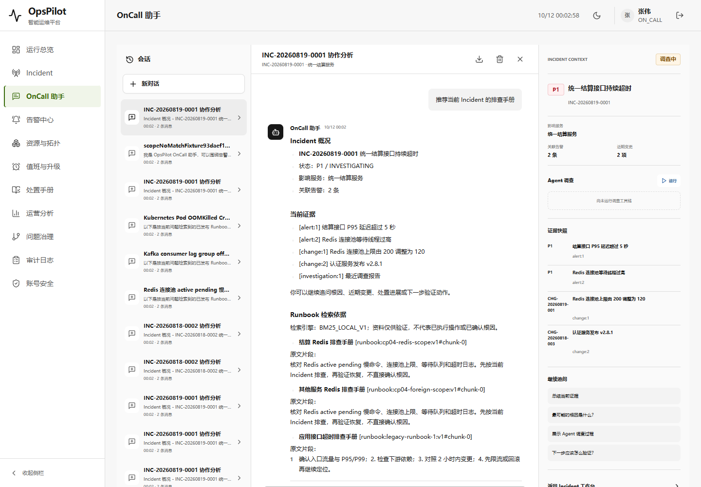
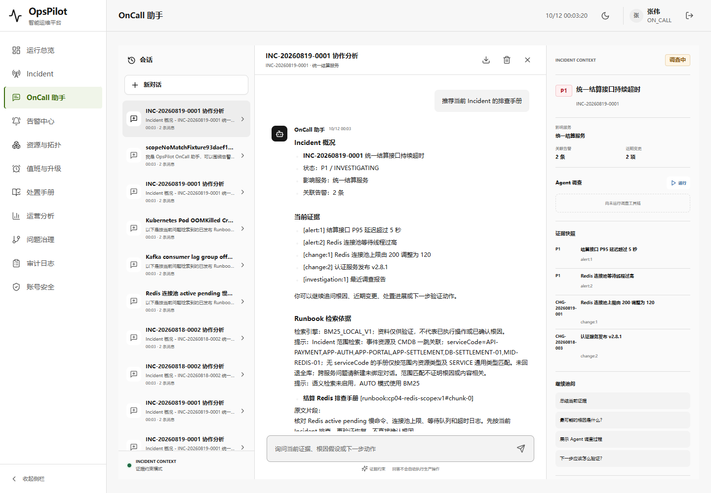
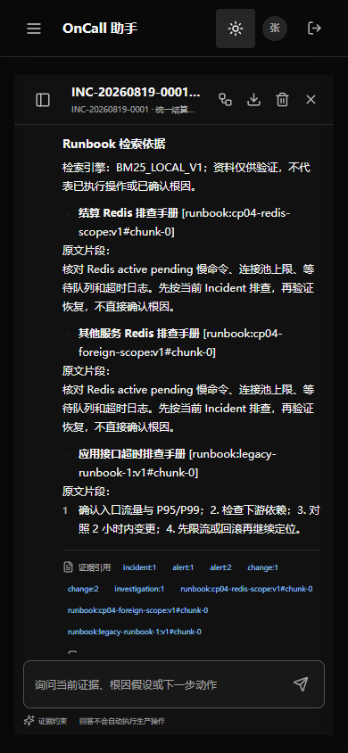
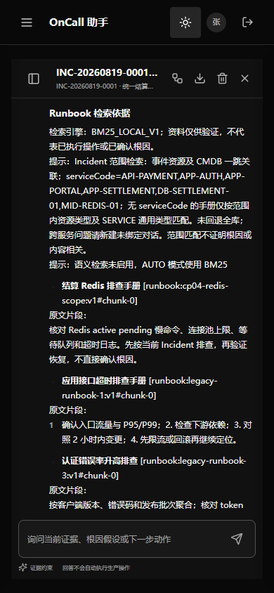

# V1.8 CP04：Incident 范围内的 Runbook 检索

接续 [CP03](V1.8-checkpoint-03-assistant-observations.md)。本轮调查了已保留截图里的实际问题：结算 Incident 的“最新指标和日志”问答附带 Kubernetes、Kafka、MySQL 专用手册；当前普通助手的候选集只受角色/发布约束，不使用绑定事件的资源范围。

## 第一阶段：实现与验收口径

- 绑定会话从数据库 Incident / CMDB 获取事件资源和双向一跳关联，不能由问题、模型或客户端指定范围。
- 已有 PUBLISHED + ACL 查询再加元数据约束：有 serviceCode 的手册必须精确匹配上述资源代码；无 serviceCode 的通用手册按范围内资源类型或 SERVICE 通用类型匹配。不推断代码别名，不递归扩展多跳。
- 在 BM25 / 语义候选生成之前过滤，不把全库 topK 的结果事后删掉冒充 scoped topK。为空不回退全库；未绑定会话与既有 Runbook 搜索 API 保持全库行为。
- 不改原 BM25 分词/评分、RRF 算法、向量内容或 500 字问题预算；scope 是来源于服务端的候选限制，不是根因证明、ACL 替代或普遍相关性提升。
- 规则回答显示范围及跨服务问题提示，模型收到同一 warnings 并提示披露范围；本次 citation 白名单仅包含 scope 内实际检索结果。模型自然语言是否遵循提示另需评测。
- 当前 CMDB 变化只影响新检索，已完成键的原版本答案仍按原快照回放。原历史、版本、独立发布规则及 Demo 不动，无迁移。起初不计划改 UI，实页复核发现多会话挤出输入框后补了下述最小布局修复。

流程参考 [Milvus 标准 filtered search 官方文档](https://milvus.io/docs/filtered-search.md)：先按元数据限定候选，再搜索并取 topK。这里是设计借鉴，不是重新引入 Milvus，也不宣称与其算法/性能等价。原归档 OnCall 的检索仍仅作为固定能力基线，尚无原 Milvus 全语料/模型 A/B。

使用 karpathy-guidelines 只改既有检索入口和助手接线；使用 frontend-testing-debugging 验证登录→绑定事件→同题问答→SSE/回读/刷新→未绑定全库对照。Browser plugin 不可用，使用项目已有 Playwright / Chrome，不安装依赖。

## 第二阶段：131 项相关测试通过

JDK 21 / Maven 3.9.16 本地首轮 131 项、最终测试并打包再次 131 项通过，0 failures / errors / skipped，最终日志 `target/assistant-scope-tests-package.log`。首轮之后把新增测试的固定候选数改成“既有候选数 + 3 个新合法样本”，避免同一套件其他已发布测试文档导致顺序依赖；没有修改生产候选逻辑以迁就测试。

新增 7 个助手场景：scope 前置并补满 topK、直接/反向一跳与二跳/资源类型排除、无回退但未绑定保持全库、ACL/发布与空 scope、正常/原生共同上下文、角色可见但范围外 citation 拒绝、CMDB 变化后的已完成原键快照。新增 Hybrid 场景用受控 EmbeddingModel 构建真实本地索引并走真实语义候选/RRF 排序，范围外高排名 Kafka 不参与本次排序、scope 内 3 候选补满结果；不是云 embedding/检索质量证明。原 15 项指标日志、7 项引用、14 项 AI 流、18 项原生端点、32 项撤权、11 项事务、5 项知识库、BM25 2/RRF 2 及原 Hybrid 1 项一起通过。

## 第三阶段：冻结同题、同语料的整包对照

2026-10-12 最终验证通过。比较 CP03 `opspilot-v1.8-assistant-observations.jar` 与 CP04 修复版 `opspilot-v1.8-assistant-scope-ui.jar`，不是原始 Milvus/云模型 A/B。预先冻结的 [10 题数据集](../../scripts/fixtures/assistant-runbook-scope-cases.json)包括两个 Incident、无绑定的 Redis/Kafka/Kubernetes/no-match 和明确跨服务问题；新旧同 8 篇手册（6 个种子 + admin 导入、lina 独立发布的 2 篇带明确 serviceCode 手册），元数据、版本及正文 hash 完全一致。逐题原文/排名、实际保存证据、候选数及截图见 [qa.json](../assets/v1.8-assistant-scope/qa.json)。

| 冻结题集指标 | CP03 | CP04 |
| --- | --- | --- |
| 6 道绑定题的范围外引用 / 返回引用 | 7 / 15 | 0 / 12 |
| 范围外引用率 | 46.67% | 0% |
| 8 道有相关性标签题的 Hit@3 | 87.50% | 100% |
| 同 8 题 MRR | 0.875 | 0.9375 |
| 同 8 题 Precision@3 | 50% | 54.17% |

相关性标签在运行前声明；Hit@3 按每题是否至少含一条相关手册，MRR 按第一条相关结果的倒数排名，Precision@3 每题分母固定 3，不因少返回而提高分数。两道无相关性标签题不计入这三个质量指标；跨服务题仍参与范围违规统计。不能外推生产检索质量或把 Hit@3=100% 解释为每条返回都正确。

四道未绑定题的排序完全一致；既有公共 Runbook 搜索继续全库 Kafka top1、8 个候选。绑定跨服务 Kafka 题旧版返回 Kafka，新版返回空并披露未回退全库。**仍有真实不足**：认证事件泛问的 top1 是通用接口超时手册，top2 才是认证手册；结算题也可能包含范围合法但内容不够相关的通用认证手册。无 serviceCode 仅按类型匹配，本轮不解决全部语义错排、CMDB 失准或资源别名。

每个 JAR 独立临时 H2，loopback 9913/9914，AI/语义/外部 Provider/后台任务关闭，不连用户数据库或生产基础设施。每包 10 次普通问答 + 1 次真实页面 SSE，SSE 拼接文本/证据与保存响应一致，同键重放无新增检索，刷新保持原文。认证关闭 JVM 后用 [只读 JDBC 观察器](../../scripts/fixtures/AssistantScopeSqlObserver.java)查询：均恰好 11 条 ASSISTANT 检索记录；旧版候选均 8，新版 Incident1 为 4、Incident2 为 2、未绑定为 8；结果 stableKey 与回答引用一致。两包 exit0、端口释放，JAR hash 保持。

## 第四阶段：实页反例与最小 UI 修复

首个 CP04 业务包已通过问答验收，原报告 [business-first-pass.json](../assets/v1.8-assistant-scope/business-first-pass.json)保留。该次截图复核发现桌面 11 条会话撑高 CSS 默认网格行，输入框底部到 1053px，超出 1000px 视口；原业务验收未断言布局，因此不把第一次 PASS 当 UI 已健康。

按 frontend-testing-debugging 的实页复核要求，补 `grid-template-rows: minmax(0, 1fr)` 和会话侧栏 `min-height: 0` 两处 CSS，再增加 DOM 几何与列表滚动断言，没有更换 OKX 风格、主题、字体或 Vue 业务逻辑。231 项前端测试及 vue-tsc/Vite 构建通过，最终包单独命名，不覆盖首个 CP04 包。

| 实页检查 | CP03 | CP04 修复版 |
| --- | --- | --- |
| 1440×1000，输入框 top / bottom | 999 / 1053，屏外 | 883 / 937，可见 |
| 桌面会话列表 clientHeight / scrollHeight | 826 / 826，不独立滚动 | 710 / 826，可独立滚动 |
| 390×844，输入框 top / bottom | 740 / 794，可见 | 740 / 794，可见 |
| 初始、刷新、滚到检索依据 | 旧桌面反例复现 | 新版各采样点可见 |
| 页面 / console warning、error / HTTP≥400 | 0 | 0 |

真实页面流程：登录→已绑定事件会话→输入并发送→SSE→回读/同键重放→刷新→切换深色→手机→滚到检索依据。标题、路由及 session identity、非空页面、无 Vite overlay、无横向溢出均断言。已有 Playwright 1.63.0 + Chrome，Browser plugin 不可用；有条件可接入 Browser plugin 做后续交互复核，本轮不安装依赖。font-family、theme.js 与 favicon 的新旧 hash/值相同；发布 CSS/JS/index 是本轮重建输出，不能再称全部静态资源不变。

## 产物、复验与交付边界

最新本机 Demo：`target/opspilot-v1.8-assistant-scope-ui.jar`，SHA256 `5d5a006ec6af3e0413cb5a84d1d58c26599df3b77ffd411ec747bea6d1c93f54`。首个 CP04 业务包 `target/opspilot-v1.8-assistant-scope.jar` 的 SHA256 `fe32ea8b2f01b1318c50dcd989a28a63076eca6c266ab578596c670ba69070be` 保持。包括它在内的八个既有 JAR 全部按 [proof.json](../assets/v1.8-assistant-scope/proof.json)复核；这些 JAR 是本机产物，不自动上传 GitHub。

提交到既有业务分支 `work/opspilot-assistant-runbook-20261011`，父版本 `edb9f8b`。限定为 3 个 Java 生产文件、1 个 CSS、2 个 Java 测试、3 个验收脚本/夹具、发布静态输出及本轮文档证据；使用独立 Git 索引，不切换工作区、不修改主索引或 HEAD，不混入其他 dirty。远端已有历史静态文件保留，封版/原归档/UI/WIP 引用不移动。当前静态目录由 Vite 重建，旧物理生成 JS/CSS 已替换，可从历史 Git/JAR 恢复；历史 Demo 本身不删。

实际使用 JDK 21 / Maven 3.9.16 / 本机缓存、D:/Node 下 Node/npm，仓库根目录的 PowerShell 复验：

```powershell
$env:JAVA_HOME = 'C:/Program Files/Java/jdk-21'
& D:/tools/apache-maven-3.9.16/bin/mvn.cmd -o '-Dmaven.repo.local=D:/Codex/国网/tmp/m2-repository' '-Dtest=AssistantRunbookIntegrationTest,AssistantObservationIntegrationTest,AssistantCitationGuardTest,AssistantAiStreamingTest,AssistantTransactionIntegrationTest,AssistantNativeEndpointIntegrationTest,AssistantSessionRevocationIntegrationTest,RunbookKnowledgeIntegrationTest,RunbookHybridRetrievalIntegrationTest,Bm25RetrieverTest,ReciprocalRankFusionTest' package
Push-Location web
$env:Path = 'D:/Node;' + $env:Path
& D:/Node/npm.cmd test
& D:/Node/npm.cmd run build
Pop-Location
& D:/tools/apache-maven-3.9.16/bin/mvn.cmd -o '-Dmaven.repo.local=D:/Codex/国网/tmp/m2-repository' '-DskipTests' package
& D:/Node/node.exe scripts/verify-assistant-scope-packaged.cjs --before target/opspilot-v1.8-assistant-observations.jar --after target/opspilot-v1.8-assistant-scope-ui.jar
```

最后一次 package 仅装入 CSS 重建资源，Java 源码/测试没有再变，使用此前最终 131 项证据；不是又跑一次 131 项。命名 JAR 的首次复制由本轮完成，不用复验命令覆盖已有命名产物。Java 汇总/log/XML hash 见 [java-results.json](../assets/v1.8-assistant-scope/java-results.json)，前端及 UI 打包日志 hash 见 [web-results.json](../assets/v1.8-assistant-scope/web-results.json)。首次 UI 打包命令曾因未引号包裹 PowerShell `-D` 参数而解析失败，正确加引号后打包成功；不把该调用失败解释为生产缺陷。

无新数据库迁移、实际 MySQL、云 embedding/模型、生产规模容量或完整远端 CI 证明。`work/**` 不触发当前 CI，因此推送不是 CI 通过。CP03 的真实 Provider 证据按原报告阅读，本轮 Provider 关闭，不冒充重新验证。整个持续目标仍 active；下一候选是扩大冻结相关性题集，再评估是否值得调整排序，而不是直接增加外部依赖。

## 截图

均为上述新旧命名 JAR 的实际页面，完整 8 张在证据目录。以下先列桌面旧/新，再列手机旧/新：





