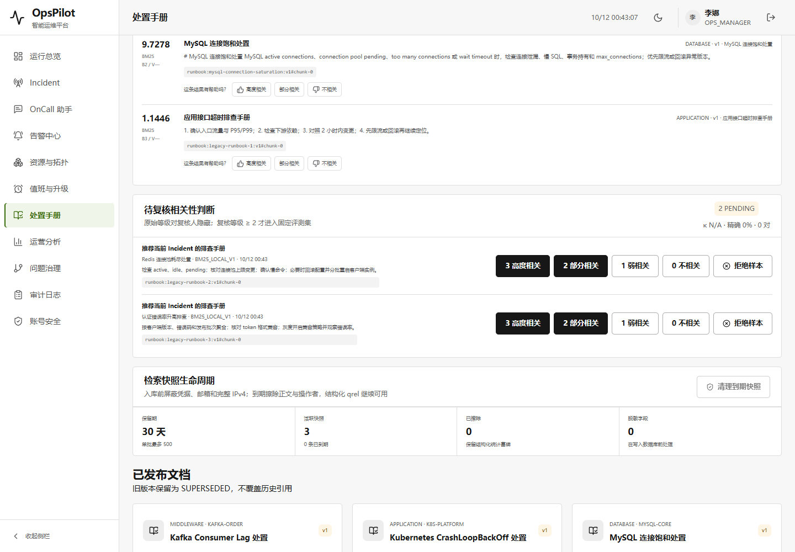
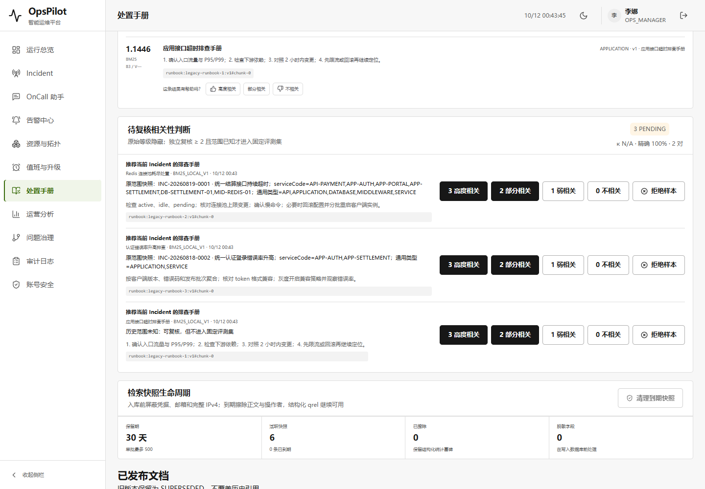
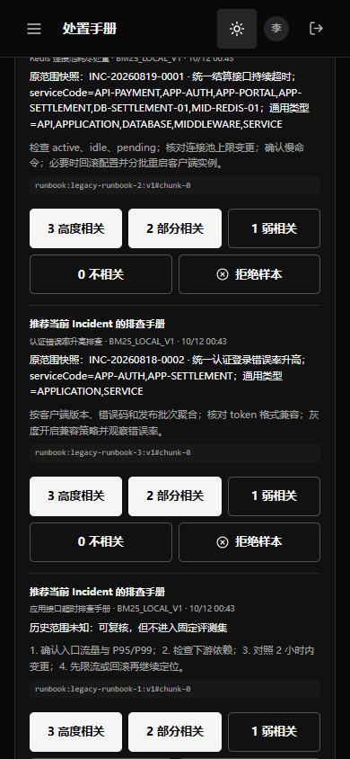

# V1.8 CP05：保留检索范围的人工反馈与评测

接续 [CP04](V1.8-checkpoint-04-assistant-scope.md)，2026-10-12。检查既有 Runbook 人工复核/固定集发现：助手已经按 Incident 范围检索，但 telemetry 不记录范围，批准标签后只按问题文字分组，再用全库重搜计分。两个事件问同一句话会混并，无法用来可靠评价后续排序。

## 第一阶段：先复现，再修复

新增真实 H2/既有检索/独立复核的反例测试：两个不同 scope、同一句“推荐当前 Incident 的排查手册”、两条正相关标签，预期两个查询；原实现实际只有一个。首次失败日志 `target/scoped-eval-baseline.log` 和 XML 保留；没有先修改评分来让它通过。

- V43 保存 query 与 qrel 的 GLOBAL / SCOPED / UNKNOWN，以及原服务代码、类型、Incident ID/code/title 快照；不允许客户端或模型提交 scope。
- 同题同规范化 scope 聚合评分，不同原范围或 Incident 身份分开；固定集版本包含该范围与策略。BM25、Hybrid、原关键词基线均按同一原候选边界重放，不修改排序算法。
- 已完成助手原键仍回放原答案；新检索才记录新范围。评测采用原快照，不把当前 CMDB 变化当作当年的信息需求。
- 旧 ASSISTANT 记录无法区分绑定/未绑定，迁移明确 UNKNOWN，不从返回文档反推、不改原 payload、标签和 enabled 标志。旧 promoted qrel 仍保留，但新评测显式排除并披露数量；UNKNOWN 可独立复核但不能晋升新固定样本。
- 损坏范围不能降级全库；范围中的敏感文字不保存为可重放过滤器，转 UNKNOWN。到期 query 清理范围 payload，已独立批准的 qrel 有自己的安全快照。
- 审核页面显示原范围；历史评测没有新范围策略时加提示，保留原运行记录，不改写旧指标。

参考 [Stanford《Introduction to Information Retrieval》评测章节](https://nlp.stanford.edu/IR-book/html/htmledition/information-retrieval-system-evaluation-1.html)：相关性针对信息需求，而不只是相同的查询字面。将 Incident/范围纳入评测身份是本项目的设计推断，不是声称该教材规定了本数据库实现。

使用 karpathy-guidelines 沿用既有检索/复核/评测，不另建一套平台；frontend-testing-debugging 复核真实审核页面。Browser plugin 不可用，使用已有 Playwright/Chrome，不新增依赖。

## 第二阶段：144 项 Java 与 231 项前端通过，整包升级继续

最小修复后首个反例已通过。扩展回归首轮 93 项中 2 个新测试断言失败：既有 judgmentCount 是规范化后的 query/document qrel 数，三个原判断应聚合成两个 qrel；Flyway 初始 schema history 记录 version 为 NULL，排除 V43 的 SQL 需保留它。原判断数量和初始化记录必须保留，修正测试口径，不改变生产聚合/迁移来迎合断言。首轮日志/XML 保留。

最终 144 项相关 Java，0 failures/errors/skipped，测试并打包成功：原 CP04 的 131 项 + 7 个 scoped 评测场景 + 1 个非空 V42→V43 H2 升级 + 既有反馈 1/生命周期 2/一致性 2。前端 231 项、vue-tsc/Vite 构建通过。新包 `target/opspilot-v1.8-scoped-evaluation.jar` SHA256 `439b86475a193c2455bf1ef3de6d7998df72f76636393e6456a82e186071d3a1`，独立命名，不覆盖既有九个 Demo。

首轮实页验收在旧包审核阶段失败：新临时库还没有评测记录，页面 `/evaluations/latest` 返回预期的 404，但 Chrome 也报资源加载 error，触发脚本的“零错误”断言；原结果 `opspilot-scoped-eval-ep7162/qa.json` 保留。后续先通过实际 API 执行种子评测，再观察待复核队列，不过滤 HTTP/console 错误，也不修改评分或标签。本轮限定验证“已有评测的审核工作流”，不声称首次空评测页面无 console error。

## 第三阶段：实际非空升级、SSE 与独立复核通过

业务包和 UI 修复包分别完成四次真实 JAR 生命周期；最终 [qa.json](../assets/v1.8-scoped-evaluation/qa.json)通过。旧包为 CP04 `opspilot-v1.8-assistant-scope-ui.jar`，先实际发起两个绑定 Incident 的同题 SSE，再重启旧包评价、独立复核；新包在同一临时 H2 执行 V43，再重启新包提交/审核新样本。每次都用新的真实登录 token、健康检查及认证关闭，四个 JVM 均 exit0/端口释放，不访问用户数据库或外部 Provider。

| 步骤与实际口径 | 查询数 / qrel 数 | 验证 |
| --- | --- | --- |
| 原固定种子 | 13 / 13 | 既有全库样本 |
| 旧包批准两个不同范围的同题标签 | 14 / 15 | 只增加 1 个查询，实际混并复现 |
| 新包升级，原两个标签范围 UNKNOWN | 13 / 13 | 标签/原 enabled 保留，明确排除 2 条 |
| 新包批准两个原范围已知的同题标签 | 15 / 15 | 增加 2 个独立查询，不混并 |
| 额外 UNKNOWN 历史判断获批准 | 不变 | 可复核但无 promotedCaseKey |

三个阶段数据集版本不同。旧 14 题 Recall@3=0.964286/MRR=0.916667；新 15 题 Recall@3=1/MRR=0.888889/NDCG@3=0.917457，**不能把这些当作排序变好/变差的同集 A/B**。新集合是 13 个全库种子＋2 个 scoped 样本，仍不代表真实使用分布；泛问认证事件的排序不足未被“修正”或隐藏。

四次真实 SSE 的增量拼接及证据与保存消息一致。旧包已完成键在 V43 新包下仍回放完全相同的原消息；新包重启后原键同样回放，均有真实 replay header。退出后的 [只读 JDBC 观察器](../../scripts/fixtures/ScopedEvaluationSqlObserver.java)确认：4 条 ASSISTANT 检索，不因回放增加；另有 2 条审核页面默认搜索产生的 CONSOLE 检索，来源单独记录。旧 payload/hash/creator、原 qrel/启用标志与 V1–V42 checksum 完全保留，只有范围标注改变；新两个 qrel 保存不同原 scope JSON。

第二次实页脚本在升级后因把 CONSOLE 算进助手总数失败：实际是 5 条总记录、4 条 ASSISTANT，而非重复检索。根据只读 SQL 及既有 Vue onMounted 的实际默认搜索修正来源断言，保留 [第二次失败](../assets/v1.8-scoped-evaluation/native-attempt-2.json)，不删除额外记录、放宽助手 4 条断言或修改生产流程。[第一次失败](../assets/v1.8-scoped-evaluation/native-attempt-1.json)及 Java [基线反例](../assets/v1.8-scoped-evaluation/java-baseline.xml)、[首轮 93 项失败](../assets/v1.8-scoped-evaluation/java-attempt-1.xml)/[迁移失败](../assets/v1.8-scoped-evaluation/migration-attempt-1.xml)均可追溯。

## 第四阶段：审核页面与暗色可读性

实际 UI：lina 登录→处置手册→查看原范围/未知范围→点击“3 高度相关”→对应卡片消失并显示已进入固定集→其余样本由实际 HTTP 独立复核→运行评测。没有拦截或伪造 API。1440×1000 浅色、390×844 深色、页面身份/非空/无 overlay/无横向溢出、console warning/error 和 HTTP≥400 为零；桌面初始视口与审核队列、手机调整视口后的审核状态均截图复核。不同范围的重复问题能看到不同 Incident code/title、服务代码与类型；历史未知样本明确提示不能进入固定集。

首个业务包 PASS 后视觉复核发现暗色审核正文仍使用原有硬编码 `#55555a` / 9px，见 [首个业务包报告](../assets/v1.8-scoped-evaluation/business-first-pass.json)和 [暗色反例](../assets/v1.8-scoped-evaluation/business-first-pass-dark-390.png)。只将该审核正文改用主题 text-muted、11px/1.6 行高；范围说明用 text 色并允许代码换行，不重新设计主题、字体、导航或其他表格。前端再次 231 项/构建通过；UI 包使用同一已验 Java，只重新打包静态资源（未重复跑 144 项），上述完整四 JVM 再次通过。

## 产物与复验

最终本机 Demo `target/opspilot-v1.8-scoped-evaluation-ui.jar`，SHA256 `f3c0252f0a4f7b66293ff73ba9460bc087554045261226e4de79bb964161af4c`。首个业务包 `439b8647…` 和另外九个旧 JAR 保留，共十个既有 Demo 按 [proof.json](../assets/v1.8-scoped-evaluation/proof.json)复核。JAR 是本机产物，不自动上传 GitHub；静态 CSS/JS/index 随本轮重建替换，旧构建输出可从历史 Git/JAR 恢复，历史远端 hashed 资源保留。

分支 `work/opspilot-assistant-runbook-20261011`，父提交 `b12f8af`。限定 4 个 Java 生产文件、V43、RunbooksView、2 个测试、2 个验收入口/观察器和文档/证据/静态资源，独立 Git 索引上传；不切换/reset 工作区，不改主索引、HEAD、其他 dirty 或封版/归档/UI/WIP 引用。旧 `<details>` 历史区块保留。

JDK 21 / Maven 3.9.16 / D:/Node / 既有本机 Maven 缓存与 Playwright/Chrome。仓库根目录 PowerShell：

```powershell
$env:JAVA_HOME = 'C:/Program Files/Java/jdk-21'
& D:/tools/apache-maven-3.9.16/bin/mvn.cmd -o '-Dmaven.repo.local=D:/Codex/国网/tmp/m2-repository' '-Dtest=RunbookScopedEvaluationIntegrationTest,RunbookRetrievalScopeMigrationTest,RunbookRelevanceFeedbackIntegrationTest,RunbookRetrievalLifecycleIntegrationTest,RunbookJudgmentAgreementTest,RunbookKnowledgeIntegrationTest,RunbookHybridRetrievalIntegrationTest,Bm25RetrieverTest,ReciprocalRankFusionTest,AssistantRunbookIntegrationTest,AssistantNativeEndpointIntegrationTest,AssistantSessionRevocationIntegrationTest,AssistantObservationIntegrationTest,AssistantCitationGuardTest,AssistantAiStreamingTest,AssistantTransactionIntegrationTest' package
Push-Location web
$env:Path = 'D:/Node;' + $env:Path
& D:/Node/npm.cmd test
& D:/Node/npm.cmd run build
Pop-Location
& D:/Node/node.exe scripts/verify-scoped-evaluation-packaged.cjs --before target/opspilot-v1.8-assistant-scope-ui.jar --after target/opspilot-v1.8-scoped-evaluation-ui.jar
```

复验入口只消费命名 JAR，不复制/覆盖 Demo。构建输出是默认 SNAPSHOT 包；UI 验收必须使用已经匹配当前静态资源的命名包，不自行覆盖旧命名产物。Java 汇总/log/XML hash 见 [java-results.json](../assets/v1.8-scoped-evaluation/java-results.json)，前端及打包 hash 见 [web-results.json](../assets/v1.8-scoped-evaluation/web-results.json)。

本轮没有实际 MySQL、云 embedding/模型、原始 Milvus Runtime、生产规模或完整 CI 证明；`work/**` 不触发当前 CI，推送不是绿灯。并未改变 BM25/RRF、候选过滤、500 字问题预算或原生流取消/审批控制。范围快照不是完整 Incident 证据/根因的历史重演；未知标签只能重做有已知范围的新检索，不推断原范围。首次空评测页面的预期 404 仍有 Chrome 资源 error；本轮验证的是已有评测的审核工作流。整个目标仍 active，下一步继续更广、分层的信息需求评测，而非凭这两条新样本调排名。

## 截图




