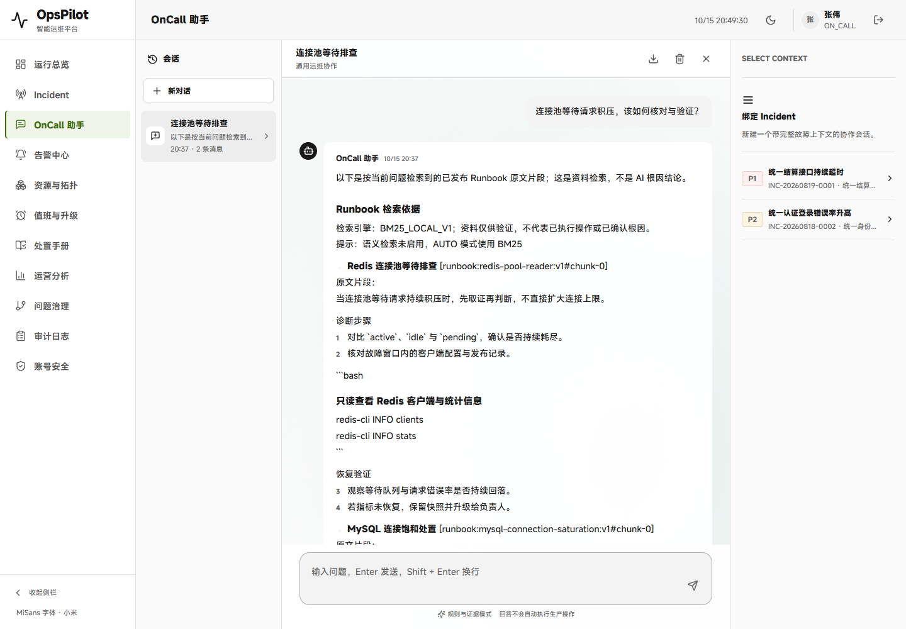
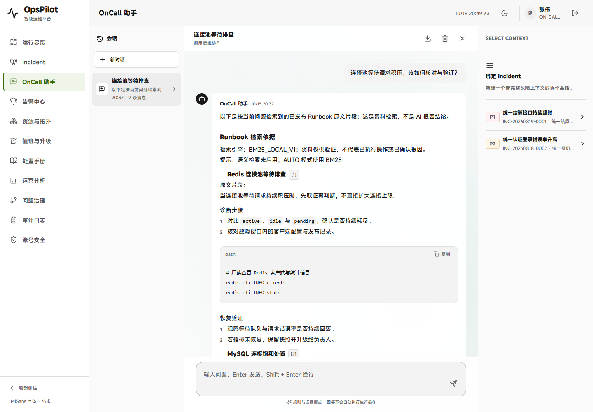

# V1.8 CP10：助手回答阅读与安全引用显示

2026-10-15，接续 CP09 `9cb03e8`。本轮源码、本机验证、独立 Linux CI 原附件与同回答新旧 Demo 对比已完成；下文初始阶段的“待验”按历史时点阅读。长期目标继续，不将局部阅读体验或受控测试当整个项目 100%。

## 已核对的实际问题

原始 OnCall 归档 `0cd654e` 的 `static/app.js` 有 `initMarkdown/renderMarkdown/highlightCodeBlocks`。当前 ChatMessage 则只逐行处理标题、列表和加粗：代码围栏显示为普通段落；编号使用全消息累计计数，两个小节中的 `1,2` 与 `1` 会显示成 `1,2,3`，甚至把无空格的 IP 前缀误当编号；正文中的完整 Runbook 引用仍占大量宽度。只折叠底部证据没有解决正文可读性。

按 `frontend-design` 沿用既有 MiSans、两主题色与 724px 阅读宽度：正文 #171717、次级 #636363、边线 #dedede、浅色白面板与 #386b0a 焦点；深色继承原 token。代码使用安静的单一文本区域，等宽字体限于代码；引用序号用于映射真实来源，不添加装饰性卡片/新动效/导航。

## 范围与待验

- 显示层不改已保存回答、复制整段、导出或流协议。代码块保留该回答中的换行/空格，以文本节点显示 HTML，不执行命令或 HTML；复制代码需显式点击，未闭合或 provisional 片段不提供代码复制，并明确显示未闭合提示。入库根因修复另列，不再把本轮称为纯前端改动。
- 识别常见 fenced code/inline code、标题和列表；编号保留原文数字，避免跨节重排。不宣称完整 CommonMark、语法高亮或所有嵌套 Markdown 兼容。[CommonMark 代码块/代码跨度规范](https://spec.commonmark.org/0.31.2/#fenced-code-blocks)作为边界参考，不引入 HTML 渲染库或新依赖。
- 只有该已保存助手消息 evidenceJson 中的规范 Runbook 引用可转为正文 `[n]` 按钮；未知引用、代码内引用和用户/实时预览内容不获得跳转能力。序号与证据列表一致，点击复用 CP08 的精确版本/当前 ACL 原文读取，不构造外部 URL。

按 `karpathy-guidelines` 限定改动与可验证条件；按 `frontend-testing-debugging` 验证真实旧/新回答、代码、引用、复制边界、键盘/手机/双主题和流。Browser plugin/`browser` skill 不可用，复用现有 Playwright/Chrome。保留原 25 份命名 JAR、默认待验包、未提交内容及现有预览；准备独立新包和同数据对比后再报告结果。真实用户数据库与配置密钥不读取/修改。

## 实页发现的入库根因与范围调整

首次 282 项前端通过；首次类型构建发现既有 TS 目标没有 Array.at，已改用索引访问而不提高运行环境要求，原失败日志保留。随后静态增量候选包的真实 RAG 页面仍失败：RunbookTextProcessor 把 fenced code 中的 `# 参考` 当标题，截断了被引用片段的闭合围栏。新显示器因此忠实显示一个未闭合代码块，把后续检索段落也纳入了它；不能通过删除测试中的代码注释掩盖问题。

因此只扩入一个业务源文件：分块时跟踪 backtick/tilde 围栏，围栏内部不按 `#` 切章节，合法闭合后再恢复标题分块。既有 1200 字上限、重叠、tokenize 和排序不变；旧文档/块/回答不重写，只影响后续新导入/修订版本。过长或历史不完整片段仍提示未闭合，不提供整块复制；不会冒称重建了旧版本。

新增五个分块单测及 H2/MySQL 共用的第七个真实导入/审批/引用读取用例；CI 仍严格核对相同方法，原六项未删、未放宽。原生 MySQL 全选预期从 36 增到 38，专门引用契约从 12 增到 14。前端静态失败候选包继续保留，最终包另命名，不覆盖原物。

最终 UI 旧/新比较将使用同一已保存回答：先通过修正入库的受控资料生成并正常关闭，再将数据库冷拷贝给原 JAR，仅观察同一消息。原 JAR 首次独立导入时的截断失败单独保留，不把该冷拷贝比较说成旧入库算法已正确，也不以正文读得更好声称检索准确率提升。

## 本机验证阶段

[本机汇总](../assets/v1.8-answer-reader/local-proof.json)、[原始入库失败](../assets/v1.8-answer-reader/first-ingestion-failure.json)、[同消息旧/新与原生流](../assets/v1.8-answer-reader/local-ui/qa.json)、[真实 MySQL](../assets/v1.8-answer-reader/local-mysql/qa.json)、[严格的同七项来源契约](../assets/v1.8-answer-reader/local-contracts.json)。

- 相关 Java **170/170**；前端 **282/282**；Node **299/299**。原生 H2/MySQL 八套共享契约 **38/38**，含引用七项×两产品共 14 项；零失败/错误/跳过，真实 MySQL 8.0.41 正常 shutdown/exit 0、端口释放。完整日志/原八份 XML 保留。
- 新增纯解析/复制用例覆盖 CRLF、空行与缩进、长/短/异类围栏、未闭合流片段、IP 不改成编号、跨节原数字、可信/未知/代码内引用、HTML 文本、复制失败、provisional 与卸载围栏。没有以 AST 测试代替实际页面。
- 六组新版真实交互通过：代码/原编号/正文引用；键盘打开同版来源并归还焦点；精确代码/原回答复制及拒绝处理；双主题桌面与两种手机高度/内部横滚；原生预览闭合代码也无提前操作；取消后无临时答案保存。
- 剪贴板边界在页面内受控拦截，验证实际按钮传入的原始字符串，不改用户系统剪贴板；不是所有 OS/权限环境的剪贴板兼容证明。原生 DashScope HTTP/SSE 只有两个 loopback fixture 调用，均关闭；没有真实云模型调用。
- 三次受控应用均正常关闭/exit 0、端口释放。旧/新同一保存回答 SHA256 都是 `e0c3421994f8135a9e8d9373e0e0b1620257c93c0a7ad13923b8ad6cb79ade39`；不是说原错误分块与修正后新入库会产生相同回答。8 张截图、0 应用错误/警告。

最终包 `target/opspilot-v1.8-answer-reader-final.jar` SHA256 `39bb5a58d22ab63887ce95d160b6bd09536d6742063d1a441c237d4654b844ca`。[二进制范围](../assets/v1.8-answer-reader/binary-scope.json)只允许 RunbookTextProcessor 类族与静态资源变化，其余 772 个非静态条目及压缩方式不变。原 25 份命名包、失败静态候选与最终包合计 27 份，不覆盖默认待验包。

源码范围核对 128 个前端文件，除助手页/消息组件/新格式化模块三个预期文件外，其余与 `9cb03e8` 一致；静态文件匹配被测 JAR。后端在从该 Git 对象导出的隔离目录仅覆盖本轮处理器与测试，未编译或打包其他工作区 Java 改动。

本阶段远端 CI 尚待独立提交验证；原五组来源 UI 与新六组阅读流程都会执行，不删除旧门禁。后续将记录 source SHA、原始附件和新独立 Demo。

## 远端独立闭合

源码 `2b68fdc143e545a2f45d63b611f85a86884ed99b` 已推送到 `work/opspilot-citation-reader-20261015`。[本轮 CI 38735752002](https://github.com/Trigger726/OnCall-Agent/actions/runs/38735752002) 的两项作业均 success。[独立核验汇总](../assets/v1.8-answer-reader/remote-proof.json)及[原始运行/附件元数据](../assets/v1.8-answer-reader/remote-metadata.json)保留 source SHA、作业、官方摘要与方法级核对。

- 数据库作业：真实 JDBC 输出 MySQL **8.4.11**、H2 **2.2.220**，同七场景各执行七项，另五项 RunbookTextProcessor 单测，总计 **19**，零错误/失败/跳过。引用契约记录中的两个 XML SHA256 与下载原 XML 字节一致，方法集合逐项相同。[原 Maven 日志](../assets/v1.8-answer-reader/remote-database/citation-contract-it/maven.log)、[原 14 项契约结果](../assets/v1.8-answer-reader/remote-database/citation-contract-it/result.json)、[完整作业日志](../assets/v1.8-answer-reader/job-0.log)均保留。
- Linux 页面作业：本次 checkout 重新构建默认 JAR，不接受历史命名包覆盖；前端 **282/282**。原五组来源 UI 与新六组阅读/复制/原生预览/取消全部通过，共 **13** 张截图，Java **17.0.20.1**。三次应用均正常 shutdown、exit 0、端口释放；同一 fresh JAR SHA256 为 `f919b474136b2392b23bc00250e77ec35ad6ef9257ae950caedcf06a109dad1f`。[原来源 QA](../assets/v1.8-answer-reader/remote-citation-ui/qa.json)、[原阅读 QA](../assets/v1.8-answer-reader/remote-reader-ui/qa.json)、[完整作业日志](../assets/v1.8-answer-reader/job-1.log)保留；503 是明确注入的来源故障，非未解释的应用异常。
- 官方数据库附件 **11973920780**，27862 bytes，SHA256 `715bf23f211ad0489fd37d0db46db6cb2c0a97b21e687c2dbd5055c74dcef96a`；页面附件 **11974605647**，2437074 bytes，SHA256 `1ba7fb4ba553a639fd48d3565f966e50ac7b6a749419f72eebcb2117da94a5f2`。实际 ZIP 长度/摘要逐一匹配，数据库文件与 ZIP 仅留忽略目录，不上传。文本证据经过密钥模式扫描。
- Windows 解压后直接重放原 CLI 仍以 `Stale XML: RunbookCitationIntegrationTest` 拒绝；这是 ZIP 时间戳转换，不伪称原 CLI 本机通过。保留拒绝，在官方 ZIP 摘要、CI 原 freshness 步骤成功、原 result 中 XML 摘要和独立方法/产品检查之上闭合，不改验证器或重写原 XML 时间。
- 源码 push 成功后的 `ls-remote` 回读遭遇 SSL timeout；通过独立 GitHub refs API 和同 SHA 的 push CI 确认成功，没有重复推送。物理 HEAD/当前分支/主 index、其他 dirty 文件、27 个命名包、默认待验包、其他保护分支及封版 tag 均有前后保留检查。

本轮是专门引用/阅读 CI，不是原完整业务 CI 重跑，也不是实际云模型、所有浏览器、真实系统剪贴板或生产环境验收。

## 独立 Demo 与实页对比

新版入口：[OnCall 助手 9930](http://127.0.0.1:9930/assistant?session=1)，演示账号 `zhangwei / OpsPilot@2026`。仅用隔离的只读 Redis 手册示例，AI 关闭，未执行任何展示命令，未读取或修改真实用户数据库。原 9900、9916、9924、9926 的进程保留。

旧版 9932 与新版 9930 从同一已正常关闭的受控数据库冷拷贝，两份初始数据库 SHA256 `b20e2cb310398e96a505f40f7ecd600e14bf472d0279cbc1076b6bca5b548632`。实际保存回答 SHA256 均为 `dfff06129edf5687b1d619137160da19c6108f91507bf97271c44fd6e141b783`。旧页显示原始围栏、把 `#` 注释当标题、步骤显示 `1,2,3,4`；新版显示独立代码区/行内代码/紧凑来源按钮，步骤为原文 `1,2,1,2`。点击正文来源实读带完整闭合围栏的同版片段；原消息字节不变。旧 JAR 读取的是修正导入后的相同数据，不代表旧导入算法正确。

Playwright/Chrome 实测 1440×1000 与 390×844；标题/URL/非空/无框架遮罩、0 控制台错误和警告、手机无页面横向溢出、来源打开/关闭均通过。[Demo QA](../assets/v1.8-answer-reader/demo/qa.json)、[运行保留检查](../assets/v1.8-answer-reader/demo/runtime.json)与[启动清单](../assets/v1.8-answer-reader/demo/manifest.json)保留。旧比较实例已通过其独立管理端口正常关闭，9932/9933 释放；新版 9930/9931 留运行。不声称未知进程句柄的退出码已取得。

可重新启动比较：先设置 `JAVA_HOME`，再执行 `node scripts/start-runbook-diversity-comparison.cjs before target/answer-reader-comparison-20261015/manifest.json`；新版同命令将 before 换为 after，需在对应端口空闲时启动，不覆盖任何旧包/数据库。示例数据与启动清单留本机忽略目录，公共证据不包含数据库。

实页截图对照：

## 后续边界

继续按价值优先审查凭证配置可发现性、跨页层级和更真实的问题分布；不因已有测试数量而自动添加功能或删除故障恢复。本轮没有新增 API 密钥设置页，没有改用户配置；现有 DashScope 仍由 `DASHSCOPE_API_KEY` 与 `AI_ENABLED` 配置。未闭合/过长历史片段、Markdown 子集、仅受控复制和非生产题集等限制保留。
