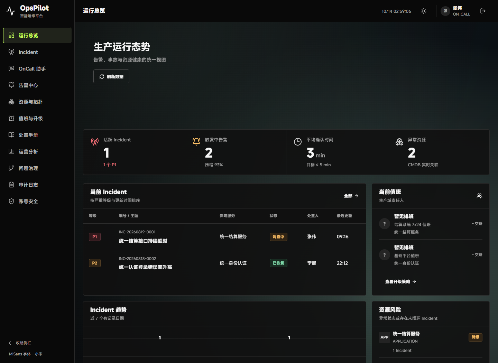
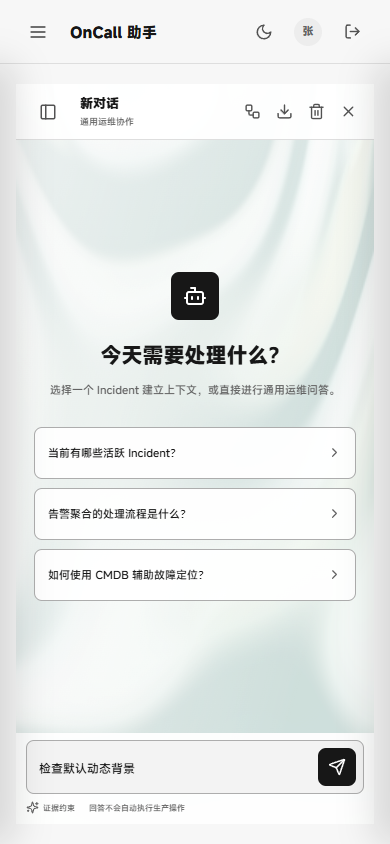

# V1.8 UI：无按钮、默认动态背景

日期：2026-10-14。用户明确要求删掉动态背景按钮，默认动态。

- 删除共享背景中的按钮、指示点、开关和相关 CSS；登录、总览、助手不再有控制按钮。
- 不读写 `opspilot_workbench_motion`，包括已保存 `false` 的浏览器也默认播放。旧键原值保留，不清除其他偏好或认证信息。
- 回收助手工具栏为动效按钮预留的空位。保留配色、MiSans、鼠标形变/波纹、30 fps/0.65 分辨率比例。
- 仍遵循系统减少动态设置，无 GPU 时静态降级；后台标签暂停及路由清理继续有效。不是强制绕过设备/系统能力。

## 验收

最终包 `target/opspilot-v1.8-ambient-autoplay.jar`，SHA-256 `2366c0742b384d78a9c010492ed429232093d89556b12e3b07442c636f857229`。

| 检查 | 结果 |
| --- | --- |
| 前端测试/构建 | 244/244，构建通过；旧手动开关测试替换为默认播放/旧键忽略检查 |
| 登录、总览、助手 | 预置旧键 false，三页均 active、1 个 canvas、0 个动效按钮，旧键不改 |
| 页面与截图 | 身份正确、非空、无错误覆盖层；1440×1050 和 390×844 无横向溢出 |
| 交互 | 真实登录、dashboard 刷新 200、鼠标驱动值约 0.30→0.58；切换浅色主题后输入草稿保留，手机输入区可见 |
| 系统/设备降级 | 减少动态、无 GPU 的三页均无 canvas，无动效分块下载，也无按钮 |
| 运行健康 | 无应用 console/page/HTTP 错误；测试服务正常 shutdown、退出码 0、9913/9914 释放 |
| 业务/旧版本 | 771 个非静态二进制条目及压缩方式一致，18 份已有命名 JAR 不覆盖，待验 CP07 不混入 |

Browser plugin not available，使用已有 Playwright/Chrome，无浏览器安装、无新 GPU 参数。验收入口 `scripts/verify-ambient-autoplay-packaged.cjs`，固定隔离端口 9913/9914 和临时 H2，不写用户演示库。新版 4 张截图只覆盖本次局部变更，不声称重跑前轮完整 16 张矩阵或全业务 CI。

已知环境项：2 条 Windows powerPreference 平台警告；Kaspersky 注入请求 origin 单列，未禁用安全软件。未新测 Safari/Firefox。MiSans 字体与既有问号回退不变。

首轮测试中的两项注入式 renderer fixture 先落入无 GPU 静态状态，因默认播放不再由旧键阻止初始化；已修正 fixture 的 ready 状态，未改变生产降级逻辑来迎合测试。[原失败日志](../assets/v1.8-ui-ambient-autoplay/first-test-failure.log)保留。

## 交付

本地预览仍是 `http://127.0.0.1:9900/`，启动脚本改用新包，保留原 `target/workbench-shaders-demo-data/demo` 演示数据。独立 UI 分支 `ui/opspilot-shaders-20261014` 接续 `aef981486b12309857138802d23133a7828e0593`；主 HEAD、索引、其他分支、历史报告和封版标签保留，未改业务脚本、Java 或 CI。

证据：[QA](../assets/v1.8-ui-ambient-autoplay/qa.json)、[二进制范围](../assets/v1.8-ui-ambient-autoplay/binary-scope.json)、[测试](../assets/v1.8-ui-ambient-autoplay/web-tests.log)、[构建](../assets/v1.8-ui-ambient-autoplay/build.log)。原始 QA：`C:/Users/lenovo/AppData/Local/Temp/opspilot-autoplay-98eEKV/qa.json`。

