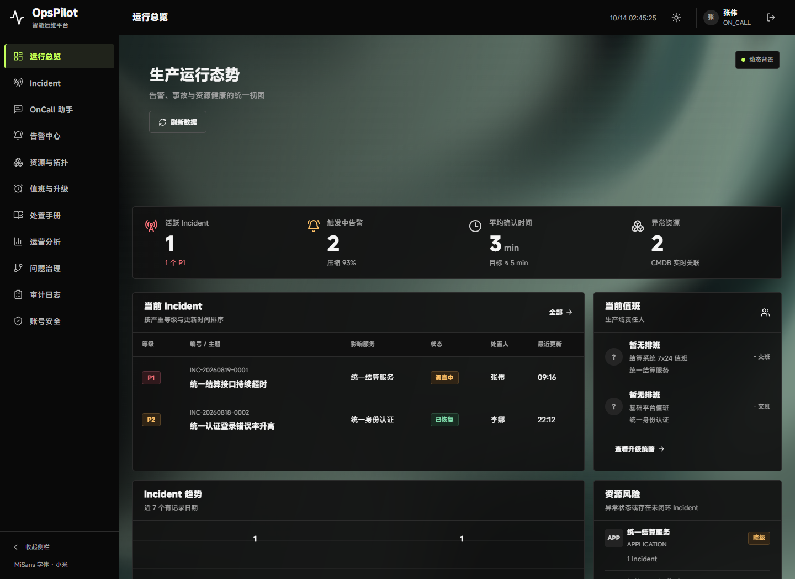
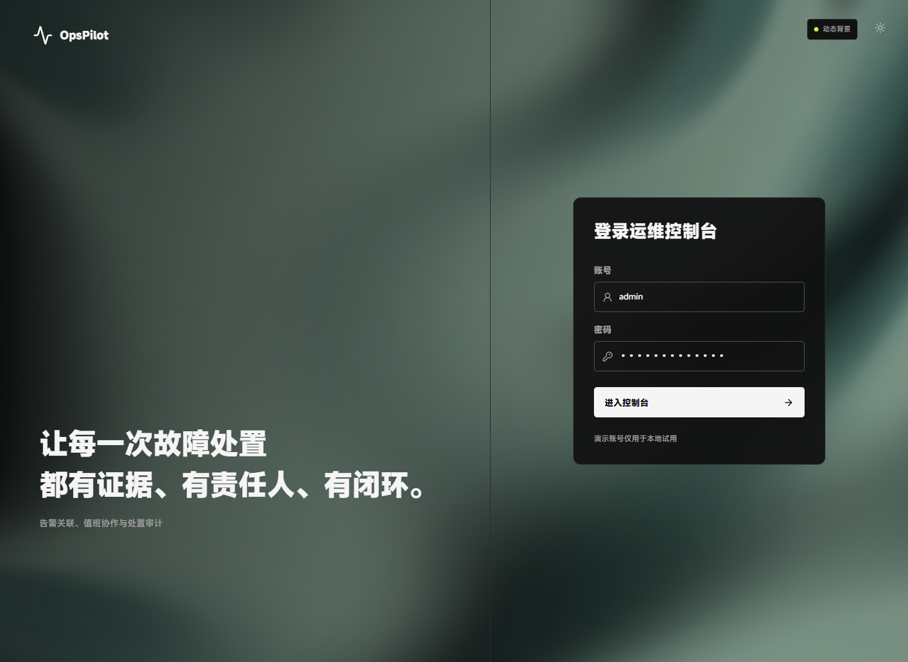
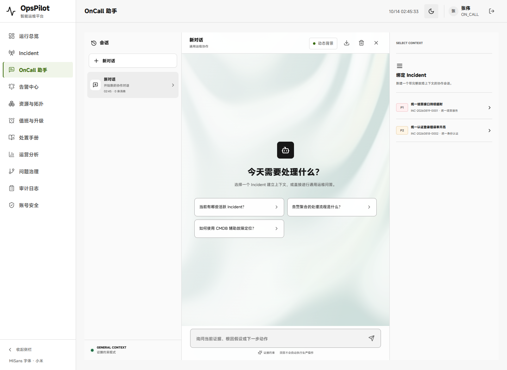
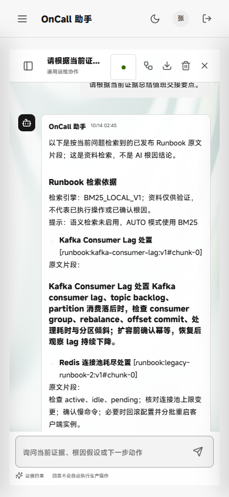

# V1.8 UI：页面级交互流光

日期：2026-10-14。范围仅为用户指定的流光面积、页面覆盖、鼠标互动与配色，继续使用现有 [shaders](https://github.com/shader-effects-inc/shaders) 4.0.4 与 MiSans。没有新增业务、模型调用、欢迎页路由或权限绕过。

## 已完成

- 总览从顶部局部背景扩展为整页内容区域；实测旧背景约 822×175，新背景 1224×1096.5。业务表格和指标保留稳定底色。
- 登录页覆盖整屏，包括品牌欢迎区域；助手覆盖整个中央对话区，空会话欢迎态和实际回复态均有流光。项目无独立欢迎路由，本轮不新增导航页。
- 原生鼠标驱动使光带形变，平滑跟随并加入轻微 CursorRipples 波纹；青玉深色/雾青浅色，采用 Linear RGB 插值消除默认色相插值带出的紫红边缘。
- 维持 30 fps 上限，将渲染分辨率比例设为 0.65。效果懒加载、关闭遥测，减少动态/无 GPU 使用静态背景。
- 暂停保存原生最后一帧并移除渲染器；恢复重建后等待 ready。主题改变时舍弃旧色静止图，用当前主题静态背景。旧异步截图不得覆盖恢复或卸载状态，Object URL 按生命周期回收。
- 登录框、消息正文与输入区保持清晰底色，背景不拦截操作；助手手机动效控制区 44×44，指示点不再被 flex 压成细线。

## 验收结果

最终 JAR：`target/opspilot-v1.8-ambient-motion-final.jar`，SHA-256 `2d4d7b888342bd7cc0b494340beb9dab6375f7f8d3b28146aeaed73a386a80fb`。

| 检查 | 结果 |
| --- | --- |
| 前端测试/生产构建 | 244/244 通过，新增 4 项动效/覆盖/暂停/恢复检查；构建通过 |
| 页面身份、非空、覆盖层 | 登录、总览、助手欢迎态、真实对话态均正常，无错误覆盖层 |
| 真实鼠标 | 四状态原生驱动值随实际移动约 0.31→0.59；原生 PNG 帧哈希变化，不以 CSS 配置或前景截图代替交互证明 |
| 暂停/恢复 | 四状态原生静止图哈希在鼠标移动后不变，canvas 已移除，恢复后重新 ready；暂停偏好跨路由保留 |
| 主题/响应式 | 1440×1050、390×844，四状态×两主题×两尺寸共 16 张新版截图，无横向溢出 |
| 手机操作 | 控制区 44×44，中心命中真实按钮；会话输入区可见 |
| 原有交互 | 真实登录、dashboard 刷新 200、助手离线检索回复、显式“继续提问”通过 |
| 降级与隔离 | 减少动态/无 GPU 三页均无 canvas、未请求 GPU 动效分块；未指定的分析页无动效渲染器 |
| 运行健康 | 无应用 console/page/HTTP 错误；隔离测试库正常 shutdown，退出码 0，9913/9914 已释放 |
| 业务保护 | 最终包只覆盖静态资源，771 个非静态条目及压缩方式一致；十五份既有交付 Demo 不覆盖，三份本轮候选/最终包独立保留 |

先尝试 IAB：环境提供的分析页标签未出现在库存，创建了后台预览标签并检查旧总览。Browser skill 未提供，IAB 接口没有连续鼠标移动能力，故自动鼠标/原生帧及响应式矩阵用现有 Playwright 1.63.0/Chrome，未安装浏览器依赖或添加 GPU 启动参数。最终本地预览仍为 9900，测试固定独立端口 9913，不写用户演示数据库。

更新后再次在 IAB 实测 `http://127.0.0.1:9900/`：1280×720、1 个 canvas、状态 active；读取的 error/warn 日志为空，实际截图已核对并保留结果标签。演示库启动日志显示 V43 已是当前版本，无新迁移。

旧版四状态实测基线来自 `opspilot-ambient-motion-cgvIU5`；后续只重跑改动包，复用已经 PASS 的旧版段，重新核对冻结旧 JAR 哈希。QA 明确记录基线来源及其报告哈希，不称为最后一次新跑旧版。最终原始 QA：`C:/Users/lenovo/AppData/Local/Temp/opspilot-ambient-motion-J3qjRN/qa.json`。

已知限制：本机 Chrome 在 Windows 上忽略 powerPreference，最终 2 条平台警告；Kaspersky 注入 origin 单列，未屏蔽安全软件，不能声称所有外部请求为零。MiSans 官方既有网页分片不含 U+FF1F，全角问号沿用微软雅黑 UI 回退；欢迎标题 8 个汉字实测 MiSans、问号 1 字回退，旧/新相同。未新测 Safari/Firefox、真实外部模型或全业务 CI。

## 实页设计复核

这是既有设计系统内的动效扩展，没有另画图片概念。参考既有页面与用户明确要求，已用图像查看工具核对前后实页。

| 比较点 | 保留/有意改变 |
| --- | --- |
| 页面结构 | 保留导航、登录双栏、助手三栏和原有业务内容 |
| 字体 | MiSans 和原文字层级不改，代码仍等宽 |
| 配色 | 原局部绿光改为深石墨/青玉与雾青；Linear RGB 防止跑出紫红色 |
| 覆盖 | 总览整内容页、登录整屏、助手中央全高；两侧资料栏保持安静 |
| 可读性 | 输入和真实消息采用稳定底色，表格/指标不随光带变色 |
| 手机控制 | 动效按钮缩为指示点但保留完整无障碍名称与 44px 触控区；无横向溢出 |

首屏业务文案、导航、标题及原按钮名称未改；登录和助手新增同一暂停/恢复控制是本轮可控动效所需，不增加营销标语。比较结果符合本轮要求，无已知未修复版式问题。

## 首轮问题和修正记录

不隐藏失败：[失败记录](../assets/v1.8-ui-ambient-motion/failures/)。

1. 首次构建的类型导入路径错误已改为库公开 `shaders/core`；保留诊断摘录（完整原 stdout 在工具历史）。
2. 字体探针一开始误要求问号也在官方网页分片中；实测揭示既有回退，明确限于该 1 字，不放宽其他字体验证。
3. 验收脚本根节点变量遮蔽、生产包省略 devtools DOM 属性、助手必须显式继续提问等探针/流程假设已修正；没有修改业务协议去迎合测试。
4. 扩大背景后，元素区域截图包含前景 UI 和 hover 状态，不能把区域哈希变化直接当背景仍在运动。最终改为库公开接口导出的原生帧/静止图哈希，并验证暂停后 canvas 移除；此前的鼠标暂停截图失败不单独作为 GPU bug 证明。
5. 实页默认 OKLCh 插值出现紫红边缘，改为 Linear RGB；手机指示点压缩修正为固定圆点/44px 控制区。触控探针等待既有响应式侧栏过渡结束后再核对命中，保留首轮立即检查失败。

## 可重复运行与交付

JDK21、已有 Node/Chrome；运行 `node scripts/verify-ambient-motion-packaged.cjs`，默认消费最终包，重新跑旧/新两包；可用 `--baseline` 参数复用已成功的冻结基线，报告会显式标注来源。前端 `npm test`、`npm run build`。未添加远端服务或新账号。

本地启动入口 `scripts/start-workbench-shaders-demo.ps1` 改用最终包；复用 `target/workbench-shaders-demo-data/demo`，不重建数据。独立 UI 分支 `ui/opspilot-shaders-20261014` 接续 `60e8657fd2a08aef5afccd605fc7ad08d9c323c6`；主 HEAD、主索引、其他分支和封版标签不动，待验 CP07 不上传。没有新完整 CI 或普遍性能提升声明。

证据：[QA](../assets/v1.8-ui-ambient-motion/qa.json)、[二进制范围](../assets/v1.8-ui-ambient-motion/binary-scope.json)、[测试](../assets/v1.8-ui-ambient-motion/web-tests.log)、[构建](../assets/v1.8-ui-ambient-motion/build.log)、[实时预览](../assets/v1.8-ui-ambient-motion/live-preview.json)。

