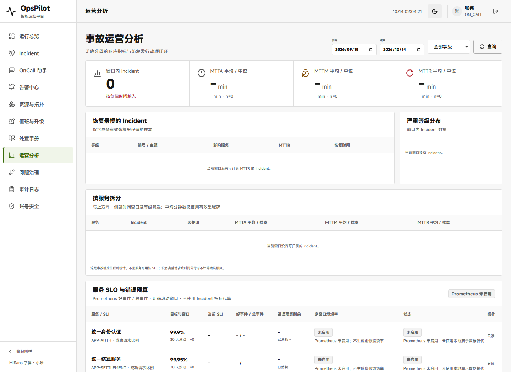
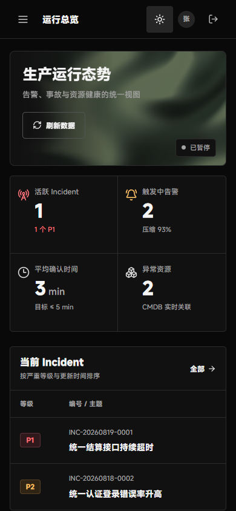

# V1.8 UI：小米 MiSans 字体

日期：2026-10-14。用户最新要求“字体用效果跟苹方差不多的字体，小米的就行”，替代此前的 Codex 默认系统字体选择。本次不重新设计布局、不改业务，也不推进待验 CP07。

## 已完成

- 全局 UI 使用 `MiSans VF`，中文系统回退为苹方/微软雅黑；代码区仍为等宽字体。
- 使用[小米官方字体站](https://hyperos.mi.com/font/zh/download/)实际引用的网页字体服务，56 个官方原始 WOFF2 共 4,523,768 字节，本地随应用提供，浏览器按官方 unicode-range 加载。未重新切分、修改字形或字体表。
- 原始字体来源、SHA-256 和本地 CSS 机械 URL 替换记录见应用资源 `assets/fonts/source.json`；可复取脚本 `scripts/fetch-misans-fonts.cjs`。
- 按[官方授权协议](https://hyperos.mi.com/font-download/MiSans字体知识产权许可协议.pdf)保留字体元数据和完整协议；侧栏明确标注软件使用 MiSans，并链接本地 PDF。不提供独立字体发行包。
- 保留双主题、主题记忆、动态背景、暂停和业务交互。不宣称 MiSans 与苹方字形完全相同。

## 实际验收

受验新 JAR：`target/opspilot-v1.8-workbench-misans.jar`，SHA-256 `d0fcb32b2b38dbcac6416ac8a9910984c4b1ddd099997f4e780704f8763275fd`。

| 检查 | 结果 |
| --- | --- |
| 前端自动化 | 240/240 通过，新增 3 项字体/完整性测试；生产构建通过 |
| 页面身份、非空、错误覆盖层 | 分析页 `/analytics` 与工作台 `/` 正确，有真实页面内容，无覆盖层 |
| 实际中英文 | Chrome 字体追踪确认分析标题、正文、英文 OpsPilot 与工作台标题均为自定义 MiSans VF，而非仅 CSS 声明 |
| 双主题、桌面/手机 | 1440×1050 与 390×844，各两页、两主题共 8 张截图，无横向溢出；切换与刷新记忆通过 |
| 动效/交互 | GPU 实际像素变化、暂停后像素稳定、真实 dashboard 刷新 200 通过；无额外 GPU 启动参数 |
| 错误/请求 | 无应用 console/page/HTTP 错误；字体来自本地，授权 PDF 匿名读取 200 且哈希一致 |
| 隔离验收退出 | 专用 H2 测试库，服务正常 shutdown，退出码 0，9913/9914 端口已释放 |
| 业务/旧版本保护 | 新包仅覆盖静态资源，771 个非静态条目内容及压缩方式一致；十四份既有命名 Demo 哈希未变 |

Browser plugin not available：使用已有 Playwright 1.63.0 与已安装 Chrome，未安装浏览器依赖。验收入口 `scripts/verify-misans-packaged.cjs`，需 JDK21，服务固定 `http://127.0.0.1:9913`；验收只登录种子演示用户，不调用 AI/真实外部运维渠道。

已知环境提示：Chrome 在 Windows 上忽略 WebGPU powerPreference，出现 1 条平台警告；本地 Kaspersky 注入请求单列为其安全软件 origin，不算应用字体/遥测，也未屏蔽安全软件。未新测 Safari、Firefox 或所有业务页面。

## 当前预览与交付范围

本地预览 `http://127.0.0.1:9900/analytics` 已更新为 MiSans 包，仍使用原 `target/workbench-shaders-demo-data/demo` 演示库，未重建数据库。启动入口 `scripts/start-workbench-shaders-demo.ps1` 默认改用新字体包；十四份旧包仍可单独启动。

继续原独立 UI 分支 `ui/opspilot-shaders-20261014`，基于字体修改前 `9e46a078fb5805d4643b5ef20074dfee48747155`。只交付字体、必要 UI、测试、构建资源及本报告证据；当前主分支、主索引、封版标签、其他远端分支及待验 CP07 不变。无新完整 CI/云模型/全业务回归声明。

原始临时证据：`C:/Users/lenovo/AppData/Local/Temp/opspilot-misans-BWGbX2/qa.json`；仓库归档见 [QA](../assets/v1.8-ui-misans/qa.json)、[二进制范围](../assets/v1.8-ui-misans/binary-scope.json)、[前端测试](../assets/v1.8-ui-misans/web-tests.log)、[实时预览](../assets/v1.8-ui-misans/live-preview.json)。

