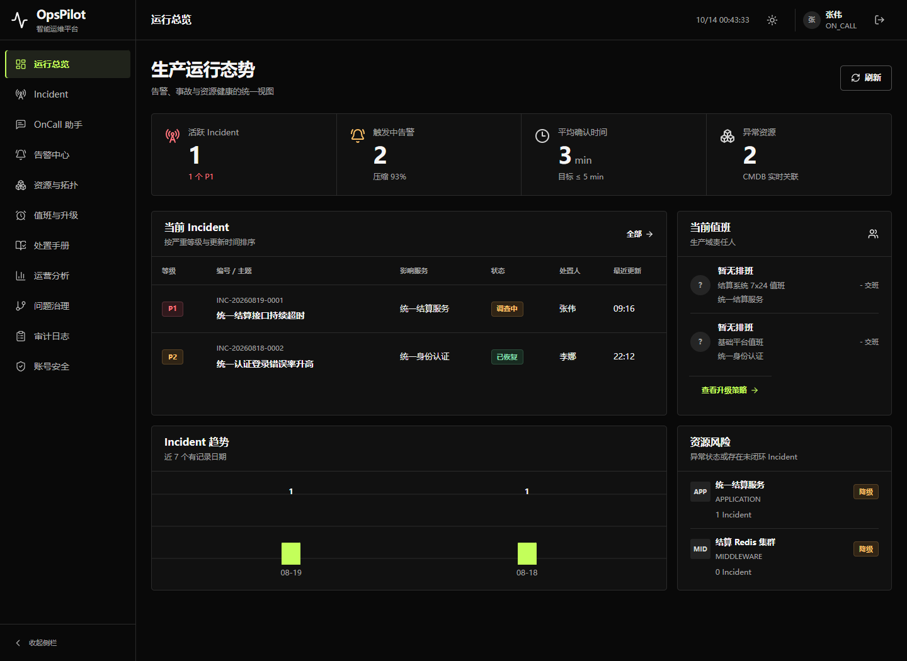
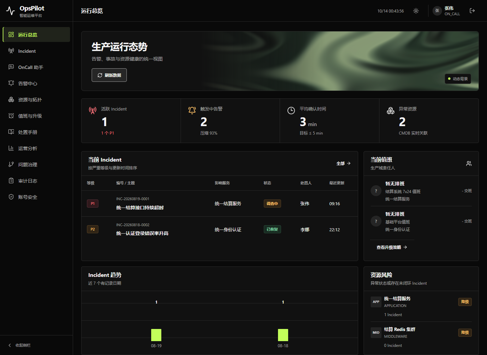
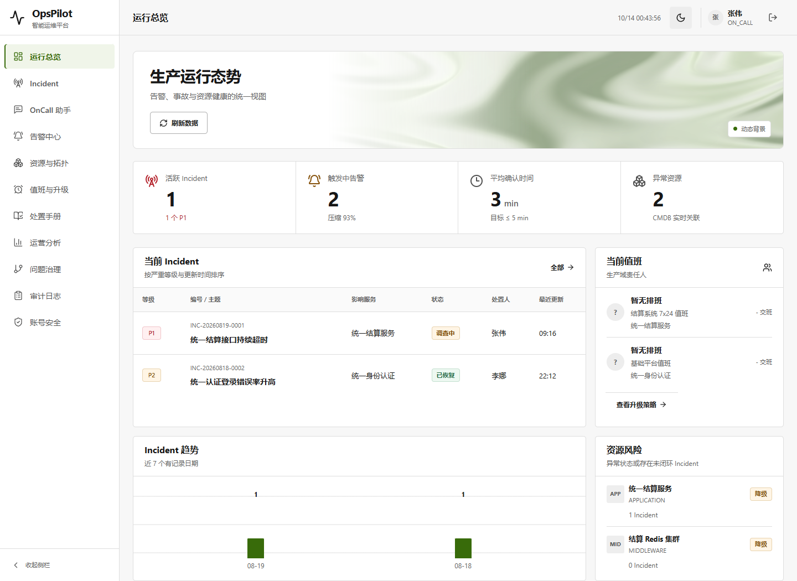
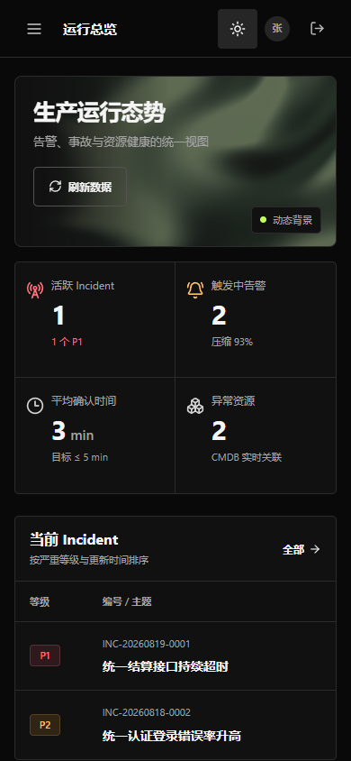

# 工作台动态背景与 Codex 默认字体修正

2026-10-14，响应用户指定 [shader-effects-inc/shaders](https://github.com/shader-effects-inc/shaders) 和 Codex 同款字体。仅改 UI，不混入仍在验收中的 CP07 检索改动。

## 已实现

- 使用固定版本 `shaders@4.0.4` 的原生 Vue `Shader` / `FlowingGradient`，不是把 CSS 渐变冒充库效果；顶部一处缓慢流动，现有业务数字和表格不变。
- 浅色/深色使用各自低饱和配色，桌面/手机保持阅读区；控件可暂停、恢复并记住偏好。
- 动态组件按需加载、30 fps 上限、禁用库遥测；减少动态设置和无 WebGPU 时不挂载 GPU 组件，保留静态背景。
- 页面隐藏时暂停，路由离开移除监听，原生 Shader 释放 GPU/尺寸/可见性观察器；不更改 Chrome 或系统 GPU 设置。
- 公开保留 [MIT 许可证](../../web/public/assets/shaders-LICENSE.txt)，随静态资源发布于 `/assets/shaders-LICENSE.txt`。

## 字体依据与限制

本机 Codex 已升级为 `OpenAI.Codex_26.1007.2314.0_x64`。只读检查安装包的 `webview/assets/app-shared-9a94b907ed47.css`，其 `--font-sans-default` 为：

```css
-apple-system, BlinkMacSystemFont, "Segoe UI", sans-serif
```

项目此前采用旧版包含 `ui-sans-serif` 的默认栈。现在使用新版默认栈，并明确添加 `Microsoft YaHei UI` / `Microsoft YaHei` 中文回退，统一正文和表单控件；代码等宽栈保持不变，没有下载或分发专有字体。

浏览器实际中文标题旧、新版均为 Microsoft YaHei UI；Latin 品牌文字实测从 Microsoft YaHei UI 转为 Segoe UI，计算样式也已更新。不是证明旧版所有汉字都是宋体，本轮不作这种错误归因。没有读取用户聊天数据库、凭证或自定义字体偏好，不能承诺与每个人自定义后的 Codex 像素完全相同。

## 本轮真实验收

237 项前端测试通过，新增 6 项覆盖减少动态、暂停持久化、无 GPU、可见性控制、存储失败/监听清理和原生库接线。

旧/新真实 JAR 的最终验收通过：GPU 像素随时间改变，暂停后像素稳定、刷新仍暂停、可恢复；实际数据刷新 200、减少动态/无 GPU 不创建 canvas、离开路由无 canvas、1440/390 两种主题无横向溢出。第一轮使用单独的 `--enable-unsafe-webgpu` 参数；最终交付 JAR 的同样验证在未加额外 GPU 参数的 Chrome 中再次通过。未改用户 Chrome 或系统设置。

首轮失败保留：截图取值早于手机布局过渡结束；另有本机卡巴斯基注入的外部请求。脚本改为等待布局稳定、单独披露此安全软件来源，不禁用安全软件、不忽略应用错误。WebGPU 的 Windows powerPreference 已知警告单独记录，不称无任何警告。

已确认新 JAR 的 771 个非静态条目及其压缩方式保持不变，包括业务类、Spring Boot 加载器和依赖。历史十一份 JAR 不覆盖；本轮候选包另存，待验 CP07 JAR 另存。

## 交付入口

最终包：`target/opspilot-v1.8-workbench-shaders-final.jar`，SHA-256 `a85850d2b5dfbb4be01e64fd5b8aaa340a46c069b4ccf68bf2a05419b9907eda`。底层业务来自原 CP05 UI Demo，CP06 只新增测试，因此没有把未交付 CP07 后端混入新 UI。

```powershell
$env:JAVA_HOME='C:/Program Files/Java/jdk-21'
& 'D:/Node/node.exe' scripts/verify-workbench-shaders-packaged.cjs
```

GPU 独立包约 2.64 MB（gzip 730.7 kB），原生 Vue 入口仍包含库的核心注册表；不虚称改用 Vue 就消除了它。按需加载使其不进入主入口，减少动态/无 GPU 用户不加载该包；首次加载仍有这笔开销。未测试其他浏览器、每种 GPU/驱动、长期电池消耗或所有业务页面。

证据：[最终 QA](../assets/v1.8-workbench-shaders/qa.json)、[二进制边界](../assets/v1.8-workbench-shaders/binary-scope.json)、[字体来源](../assets/v1.8-workbench-shaders/font-source.json)、[哈希清单](../assets/v1.8-workbench-shaders/proof.json)。控制台无应用错误，保留两条 Chromium Windows powerPreference 警告；本机卡巴斯基请求单独披露，不冒充 Shader 遥测。

启动预览：设置 JAVA_HOME 后运行 `scripts/start-workbench-shaders-demo.ps1`，默认 `http://127.0.0.1:9900`，使用单独的 `target/workbench-shaders-demo-data`，不连接已有用户数据库。示例用户 `zhangwei` / `OpsPilot@2026`。UI 独立分支 `ui/opspilot-shaders-20261014`；V1.7 封版和原 OKX UI 分支不移动，CP07 尚未封版的源码/证据仍保留，未混入此分支。

## 新旧对比






完整 OpsPilot 目标仍 active，既有未提交改动保留。此次未运行新的完整 CI或后端功能回归，用二进制逐条一致性核对证明没有更换业务实现。
